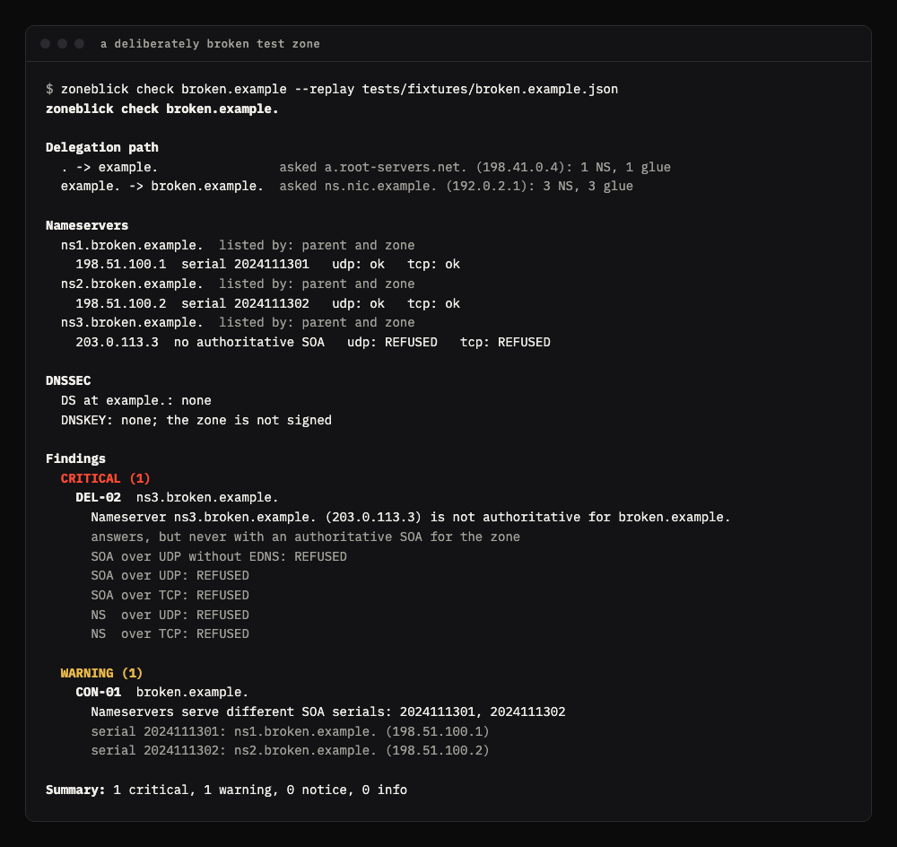
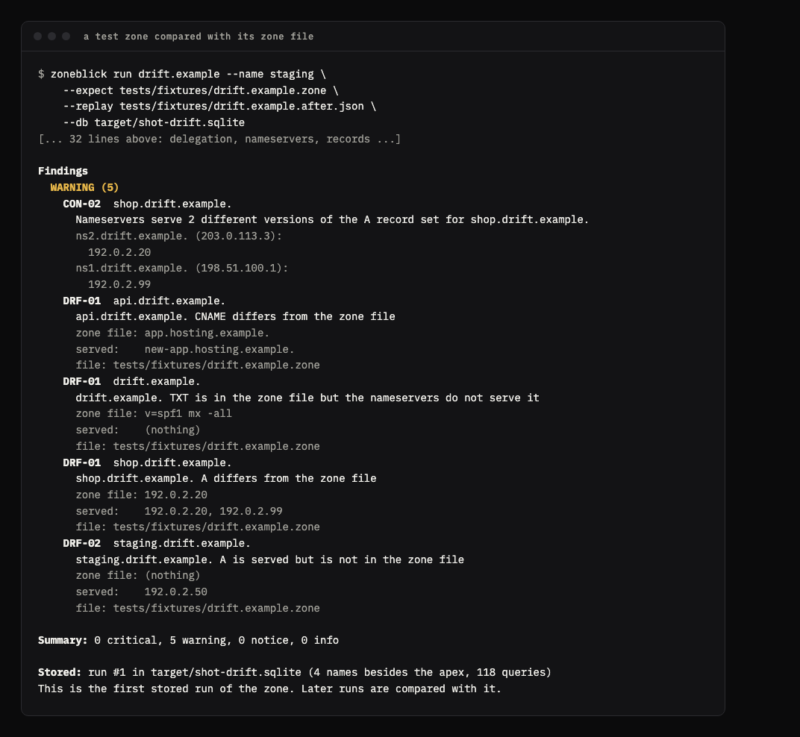
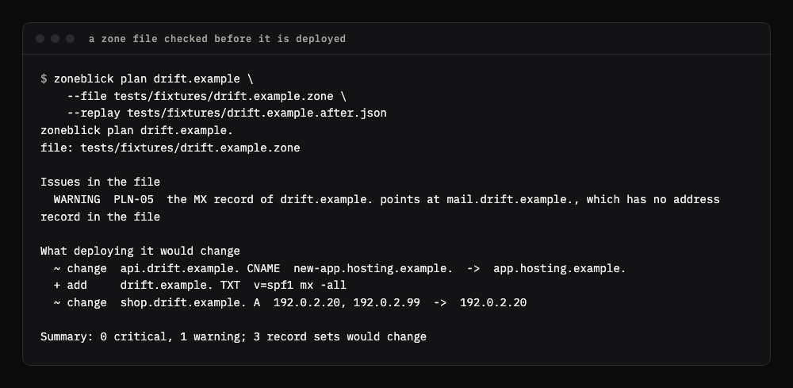
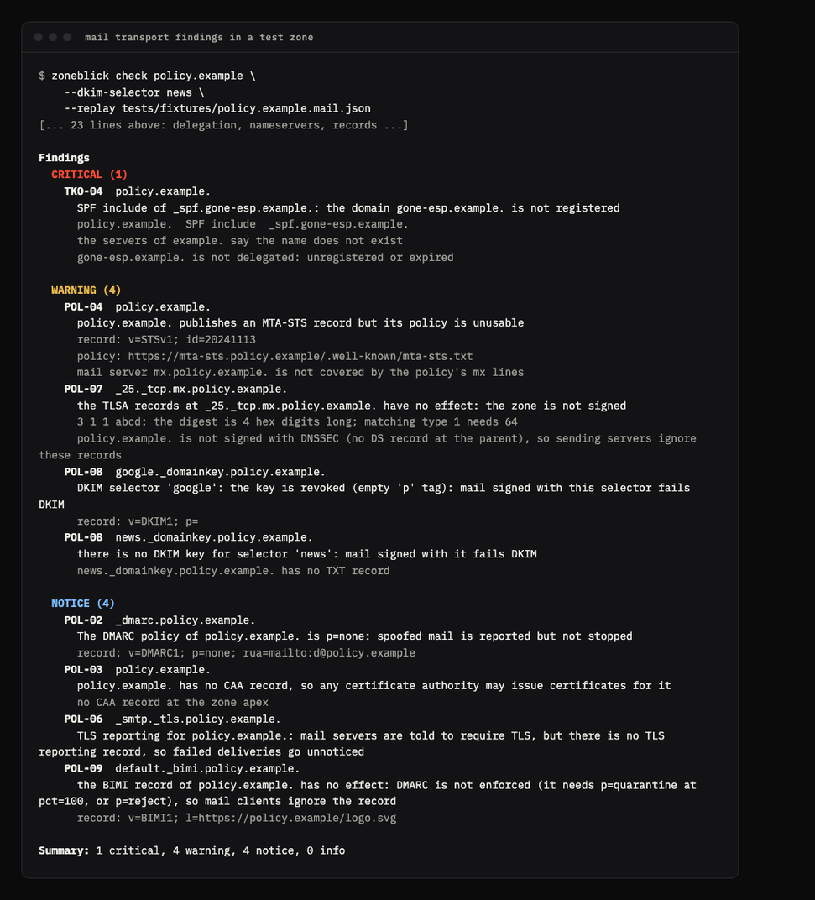
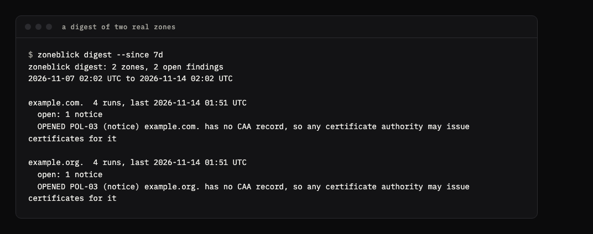
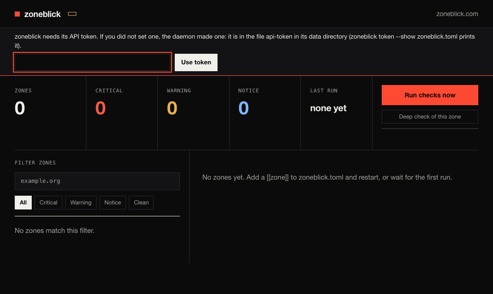

# zoneblick

A self-hosted DNS zone watchdog. zoneblick asks every authoritative nameserver for every record you care about, checks the answers, and keeps a history, so you know when your DNS drifts.

**Status:** early, but usable end to end. `zoneblick check` checks a zone once: delegation, nameserver consistency, DNSSEC, mail policy and takeover exposure. `zoneblick run` stores each run in a SQLite file and `zoneblick diff` shows what changed. `zoneblick serve` runs as a daemon: it checks your zones on a schedule, sends alerts when something changes, and serves a JSON API and a web UI. It can find more names in certificate logs, by zone transfer or at your DNS host (Cloudflare, Route 53, Gandi, Hetzner, DigitalOcean), compare against a pinned baseline or a zone file, mute findings you have accepted, export findings as JSON, CSV or SARIF, and thin out old runs by itself. There are 40 checks for every run and 32 more with `--deep`, which also follows the DNSSEC chain of trust from the root, verifies denial proofs, compares mail servers' certificates with their TLSA records and watches the domain's registration. Eleven of the deep checks are new in `v0.15.0`: subdomains delegated to nameservers that no longer serve them, the registration of the domains your nameservers and mail servers are in, the certificates your mail and web servers really present, route origin validation (RPKI) of your nameservers' networks, what Cloudflare's, Google's and Quad9's resolvers say about the zone, blocklists, weak SPF and DMARC records, and registered lookalike domains. `zoneblick plan` checks a zone file before it is deployed, several daemons can compare what they see from different places, and release files carry a verifiable build provenance. The daemon's API and web UI always need a token, which the daemon makes itself on its first start; it can serve HTTPS with your own certificate or listen on a socket file. The current release, `v0.15.0`, is an early pre-release.

- Website: https://zoneblick.com
- Demo with sample data: https://zoneblick.com/demo.html
- Design document: [DESIGN.md](DESIGN.md)
- Who it is for, with the commands for each case: [Who it is for](#who-it-is-for)
- How it is protected, and what is still open: [Security](#security)


## What it looks like

A check of a deliberately broken test zone. One nameserver refuses queries for the zone, and the other two serve different SOA serials:



A real zone, checked live (the author's own, `metaincognita.com`):


Mail-policy and takeover findings, in a test zone whose SPF record includes a domain nobody has registered:


What changed between two stored runs of a zone:


A zone compared with the zone file it is meant to match (`run --expect`). Three record sets differ from the file and one is served that the file does not have:



A zone file checked before it is deployed (`zoneblick plan`): one mistake in the file, and the three record sets that deploying it would change:



The mail checks, in a test zone whose mail records are wrong in several ways: a revoked DKIM key, a missing one, TLSA records that have no effect, no TLS reporting, and a BIMI record without enforced DMARC:



What a deep run adds for the same zone, read from its JSON output: the chain of trust from the root (which ends as "insecure" at a zone that is not signed), route origin validation of the nameservers' networks, what three public resolvers answer, the certificates the web names really serve, the registration of the domains the nameservers and mail servers are in, a registered lookalike, and the domain's own registration:


And the findings of that deep check. LAL-01 and NET-01 are deep findings; the lookalike here is the same name under `.net`, which takes mail:


The digest, here for that zone after three runs:



The web UI's history tab, for a test zone that changed in its tenth run. The strip is the timeline, one bar per stored run; below it, the changes between the selected run and the one before:


The API token, from 0.14.0. The daemon makes one on its first start in a file only its own user can read; a request without it is refused, also on localhost:


The web UI asks for the token once per browser session:



The web UI that `zoneblick serve` provides. This picture is of the [demo](https://zoneblick.com/demo.html), which is the same interface filled with invented sample data:


## Who it is for

Twelve situations zoneblick was built for, each with the commands that answer it. Every command here is explained further down.

**1. "I look after a few domains and want to hear when something breaks."** Install the daemon on a small Linux server, list the zones, and point an alert at your phone.

```
curl -fsSL https://zoneblick.com/install.sh | sudo sh
sudoedit /etc/zoneblick/zoneblick.toml      # add [[zone]] blocks and an [alerts.ntfy] url
sudo systemctl restart zoneblick
sudo cat /var/lib/zoneblick/api-token       # the token the web UI at http://127.0.0.1:8053 asks for
```

**2. "Before I sign off on a domain, I want one report of what is wrong with it."** No install, no config, no database:

```
docker run --rm ghcr.io/cschweda/zoneblick check example.org --deep
```

**3. "Our zone file is in git, and a pull request should show what it would change before anyone deploys it."** Run `plan` on the pull request; it exits 2 for a critical mistake in the file.

```yaml
- run: curl -fsSL https://zoneblick.com/install.sh | sh -s -- --version v0.15.0 --no-service
- run: zoneblick plan example.org --file dns/example.org.zone
```

**4. "Somebody edits records by hand in the DNS host's dashboard, and I want to know when the live zone no longer matches the file."** Compare every run with the file; differences are findings DRF-01 and DRF-02.

```
zoneblick run example.org --expect dns/example.org.zone
```

**5. "I need to find the forgotten subdomains that still point at something we gave up."** Take the names from certificate logs or your DNS host, check them for dangling aliases and unclaimed hosting, and hand the result to whoever tracks it. A deep run also finds subdomains that are still delegated to a DNS host where the zone is gone (TKO-07), the worst kind, since it gives away everything under the name.

```
zoneblick run example.org --discover ct --discover cloudflare --deep
zoneblick export --format csv --zone example.org > findings.csv
zoneblick run example.org --sarif zoneblick.sarif
```

**6. "Our mail must arrive, and nobody should be able to forge it."** SPF, DMARC, MTA-STS, TLS reporting, DKIM keys and BIMI on every run; with `--deep`, whether each mail server offers STARTTLS with a current certificate, the certificates against their TLSA records, blocklists, and how strong the SPF and DMARC records really are.

```
zoneblick check example.org --dkim-selector s1 --dkim-selector s2 --deep
```

**7. "We sign our zone, and I do not want to learn from our users that the signatures ran out."** A daily deep run follows the chain of trust from the root, verifies the signature on every record set, and watches key rollovers; SEC-02 warns seven days before a signature expires.

```toml
[schedule]
every = "1h"
deep = "24h"
```

**8. "We are moving to another DNS host and nothing may change on the way."** Pin the state before the move, and compare with it afterwards, however many runs lie between.

```
zoneblick baseline pin example.org
# ... move the zone ...
zoneblick run example.org
zoneblick diff example.org --baseline
```

**9. "Customers in one region say the site is down, and it works for me."** Run a second daemon somewhere else and list it as a [vantage point](#vantage-points); answers that differ by place are VAN-01, a nameserver that only one side can reach is VAN-02.

```toml
[[vantage]]
name = "frankfurt"
url = "https://zoneblick-fra.example.org"
token_file = "/etc/zoneblick/frankfurt-token"
```

**10. "DNS should sit on the same dashboard and in the same weekly report as everything else."** Scrape the [metrics](#the-api), and have a digest sent to the alert channels.

```toml
[alerts]
digest = "7d"
```

```yaml
# prometheus.yml
- job_name: zoneblick
  metrics_path: /api/v1/metrics
  authorization: { credentials: "<token>" }
  static_configs: [{ targets: ["127.0.0.1:8053"] }]
```

**11. "It resolves for me. Does it resolve for everyone?"** A deep run asks the resolvers most people use, and checks that the routes to your nameservers are covered by RPKI. A broken DNSSEC chain shows up here as what it means for users: Cloudflare, Google and Quad9 refuse every name in the zone.

```
zoneblick check example.org --deep
```

**12. "Is somebody sitting on a name that looks like ours?"** A deep run looks for registered lookalikes that take mail, and tells you once when a new one appears.

Also covered: a domain about to lapse or lose its transfer lock, yours or one your nameservers and mail servers live in (REG-01 to REG-05, in deep runs), a certificate with no renewal in sight (CRT-01) or one that has run out on the server (TLS-01), and a finding you have decided to live with (`zoneblick findings mute`).

## Platforms

zoneblick runs on Linux, macOS and Windows. The same tests run on all three in CI on every change.

| | Linux | macOS | Windows |
|---|---|---|---|
| Release binary | x86_64 and ARM 64-bit | Apple Silicon and Intel | 64-bit x86 (runs on ARM PCs through emulation) |
| Archive | `.tar.gz` | `.tar.gz` | `.zip` |
| Extra packages needed | None; the binary is statically linked, SQLite included | None | None |
| Signed | Not applicable | No; see the [macOS note](#macos-apple-could-not-verify-warning) | No |
| Build provenance | Yes; see [Verifying a download](#verifying-a-download) | Yes | Yes |
| Install with | `curl`, `tar`, `sudo install` | `curl`, `tar`, `sudo install` | PowerShell |
| Build from source | Yes | Yes | Yes |
| Colour output | Yes | Yes | Yes, in Windows Terminal and PowerShell 7; the old console may show raw escape codes |

On every platform:

- Colour is used only when the output is a terminal. Set the `NO_COLOR` environment variable to turn it off.
- zoneblick sends its own DNS queries to port 53 over UDP and TCP, so outbound DNS must be allowed. It does not use the system resolver.
- IPv6 checks need working IPv6 on the machine. Without it, the IPv6 checks are skipped and the report says so.

## Install

There are several ways to install zoneblick: the install script, a `.deb` or `.rpm` package, Homebrew, a binary download, Docker, or building from source. For CI there is a [GitHub Action](#github-action).

| Your situation | Use |
|---|---|
| A Linux server that should watch zones all the time | The [install script](#install-script-linux-and-macos) as root, or the [`.deb` or `.rpm`](#debian-ubuntu-fedora-and-rhel-packages): both set up the service |
| A laptop, for a check now and then | [Homebrew](#homebrew-macos-and-linux), or the install script with `--no-service` |
| Everything runs in containers | [Docker](#docker) |
| A check in a CI pipeline | The [GitHub Action](#github-action); elsewhere, the install script with `--version` and `--no-service` |
| Windows | [Download a binary](#download-a-binary) |
| You want to read or change the code first | [Build from source](#build-from-source) |

### Install script (Linux and macOS)

```
curl -fsSL https://zoneblick.com/install.sh | sh
```

Three common forms:

```
# a server: the binary, a zoneblick user, a starter config and a running service
curl -fsSL https://zoneblick.com/install.sh | sudo sh

# a laptop, without root: the binary only, in ~/.local/bin
curl -fsSL https://zoneblick.com/install.sh | sh -s -- --prefix ~/.local --no-service

# one exact release, refused unless its build provenance verifies (needs the GitHub CLI)
curl -fsSL https://zoneblick.com/install.sh | sh -s -- --version v0.15.0 --require-attestation
```

The script downloads the newest release for your system, verifies its SHA-256 checksum, and installs the binary to `/usr/local/bin`. When the GitHub CLI (`gh`) is installed and signed in, it also verifies the file's [build provenance](#verifying-a-download) and stops if that does not hold; without `gh` it says that only the checksum was checked. `--require-attestation` makes the provenance check mandatory. Read it first if you like: it is [`install.sh`](install.sh) in this repository.

On Linux with systemd, **run as root** it also sets up the daemon: a `zoneblick` system user, a starter config at `/etc/zoneblick/zoneblick.toml`, a data directory at `/var/lib/zoneblick`, and a `zoneblick` service, which it starts. Add your zones to the config and run `systemctl restart zoneblick`. An existing config is never overwritten. The web UI is then at `http://127.0.0.1:8053` on that machine and asks for the [API token](#the-api-token), which the service made on its first start: `sudo cat /var/lib/zoneblick/api-token`.

| Option | Effect |
|---|---|
| `--version v0.15.0` | Install that release instead of the newest |
| `--prefix DIR` | Install the binary to `DIR/bin` |
| `--no-service` | Binary only; no user, config or service |
| `--require-attestation` | Stop unless the file's build provenance verifies; needs the GitHub CLI, signed in |

Pass options after `sh -s --`, for example `curl -fsSL https://zoneblick.com/install.sh | sh -s -- --no-service`.

### Debian, Ubuntu, Fedora and RHEL packages

Each release has a `.deb` and an `.rpm` for x86_64 and ARM 64-bit on the [releases page](https://github.com/cschweda/zoneblick/releases). They install the same things as the install script run as root: the binary in `/usr/bin`, the `zoneblick` user and service, a starter config at `/etc/zoneblick/zoneblick.toml` that upgrades never overwrite, and the data directory.

```
# Debian and Ubuntu (use arm64 on ARM)
curl -fsSLO https://github.com/cschweda/zoneblick/releases/download/v0.15.0/zoneblick_0.15.0_amd64.deb
sudo dpkg -i zoneblick_0.15.0_amd64.deb

# Fedora and RHEL (use aarch64 on ARM)
sudo rpm -i https://github.com/cschweda/zoneblick/releases/download/v0.15.0/zoneblick-0.15.0-1.x86_64.rpm
```

After either, list your zones and read the token the web UI asks for:

```
sudoedit /etc/zoneblick/zoneblick.toml
sudo systemctl restart zoneblick
sudo cat /var/lib/zoneblick/api-token
```

There is no package repository, so updates are not automatic: install the newer package over the old one. The `.deb` is installed and started on a GitHub runner as part of every release build. The `.rpm` is built and its contents listed there, but it has not been installed on a real Fedora or RHEL system.

### Homebrew (macOS and Linux)

```
brew tap cschweda/zoneblick https://github.com/cschweda/zoneblick
brew trust cschweda/zoneblick      # newer Homebrew refuses a tap from outside until you trust it
brew install zoneblick
```

The formula, [`Formula/zoneblick.rb`](Formula/zoneblick.rb), installs the release binary and checks its SHA-256; nothing is compiled. The release workflow rewrites it for each new release. It was installed and run with Homebrew 7.0.11 on an Apple Silicon Mac on 2026-11-14 (version 0.15.0); it has not been tried on Intel or on Linux. Without `brew trust`, that Homebrew stops with "Refusing to load formula ... from untrusted tap"; older versions do not know the command and do not need it.

### Verifying a download

From 0.13.0 on, every release file (archives, `.deb`, `.rpm`, `SHA256SUMS`) and the container image has a build provenance attestation: a statement signed through GitHub and recorded in a public transparency log, saying that this exact file was built by this repository's release workflow from the release's tag. The checksum file alone cannot show that, because it comes from the same place as the binaries.

```
gh attestation verify zoneblick-v0.15.0-x86_64-unknown-linux-musl.tar.gz \
  --repo cschweda/zoneblick \
  --signer-workflow cschweda/zoneblick/.github/workflows/release.yml \
  --source-ref refs/tags/v0.15.0

gh attestation verify oci://ghcr.io/cschweda/zoneblick:0.15.0 --repo cschweda/zoneblick
```

The install script and the GitHub Action run the first form for you. The files are not signed with a project key, and the `.deb` and `.rpm` carry no package signature; the attestation is the verification. Releases up to 0.12.2 have none.

### Docker

Each release is published as a multi-architecture image (x86_64 and ARM 64-bit) at `ghcr.io/cschweda/zoneblick`.

```
curl -fsSLO https://raw.githubusercontent.com/cschweda/zoneblick/main/compose.yaml
curl -fsSL https://raw.githubusercontent.com/cschweda/zoneblick/main/packaging/zoneblick.docker.toml -o zoneblick.toml

# edit zoneblick.toml: list your zones
docker compose up -d

# the API token, which the daemon made on its first start
docker compose exec zoneblick /usr/local/bin/zoneblick token --show /etc/zoneblick.toml
```

Then open `http://127.0.0.1:8053` and enter the token. `compose.yaml` publishes the port on the host's localhost only. The token is kept in the data volume. Reading it this way has not been tried on a published image yet; if it fails, choose your own token.

To choose your own token, so that only its hash is stored, put the line this prints under `[server]` in `zoneblick.toml` before starting:

```
TOKEN=$(openssl rand -hex 32); echo "your token: $TOKEN"
printf '%s' "$TOKEN" | docker run --rm -i ghcr.io/cschweda/zoneblick:latest token
```

For a single check without the daemon, no config or volume is needed:

```
docker run --rm ghcr.io/cschweda/zoneblick check example.org
```

Data lives in the `zoneblick-data` volume. The image contains only the static binary and CA certificates and runs as an unprivileged user. Its base image is pinned by digest.

### Download a binary

Each release on the [releases page](https://github.com/cschweda/zoneblick/releases) has a ready-built binary for these systems. The current release is `v0.15.0`.

| System | File name ends in |
|---|---|
| Linux, x86_64 (most servers and VPSs) | `x86_64-unknown-linux-musl.tar.gz` |
| Linux, ARM 64-bit (Raspberry Pi, ARM servers) | `aarch64-unknown-linux-musl.tar.gz` |
| macOS, Apple Silicon | `aarch64-apple-darwin.tar.gz` |
| macOS, Intel | `x86_64-apple-darwin.tar.gz` |
| Windows, 64-bit | `x86_64-pc-windows-msvc.zip` |

The Linux binaries are statically linked, so they run on any distribution with no other packages. The Windows binary also runs on ARM PCs through emulation.

Each set of commands below downloads the binary, installs it and runs a first check, of the author's zone; put yours in its place. Change `v0.15.0` to install another release.

**Linux**

```
V=v0.15.0
T=$(uname -m)-unknown-linux-musl

curl -LO https://github.com/cschweda/zoneblick/releases/download/$V/zoneblick-$V-$T.tar.gz
tar -xzf zoneblick-$V-$T.tar.gz
sudo install zoneblick-$V-$T/zoneblick /usr/local/bin/

zoneblick check metaincognita.com
```

**macOS**

```
V=v0.15.0
A=$(uname -m); [ "$A" = arm64 ] && A=aarch64
T=$A-apple-darwin

curl -LO https://github.com/cschweda/zoneblick/releases/download/$V/zoneblick-$V-$T.tar.gz
tar -xzf zoneblick-$V-$T.tar.gz
sudo mkdir -p /usr/local/bin
sudo install zoneblick-$V-$T/zoneblick /usr/local/bin/

zoneblick check metaincognita.com
```

**Windows (PowerShell)**

```
$V = "v0.15.0"
$T = "x86_64-pc-windows-msvc"

Invoke-WebRequest "https://github.com/cschweda/zoneblick/releases/download/$V/zoneblick-$V-$T.zip" -OutFile zoneblick.zip
Expand-Archive zoneblick.zip -DestinationPath .

& ".\zoneblick-$V-$T\zoneblick.exe" check metaincognita.com
```

On Windows the binary stays in the unpacked folder. To run `zoneblick` from any folder, move `zoneblick.exe` to a folder on your `PATH`. The Windows binary is not signed.

Each release also has a `SHA256SUMS` file. To check a download against it, on Linux:

```
curl -LO https://github.com/cschweda/zoneblick/releases/download/$V/SHA256SUMS
sha256sum --check --ignore-missing SHA256SUMS
```

On macOS the last line is `shasum -a 256 --check --ignore-missing SHA256SUMS`. On Windows, compare the output of `Get-FileHash zoneblick.zip` with the line for the zip in `SHA256SUMS`.

To update, repeat the steps with a newer release. To remove zoneblick, delete the binary (`/usr/local/bin/zoneblick`, or the unpacked folder on Windows).

#### macOS: "Apple could not verify" warning

The macOS binaries are not signed or notarised by Apple, because that needs a paid Apple developer account. If you download the archive with a web browser, macOS marks it as quarantined and refuses to run the binary, with a message such as *"zoneblick" cannot be opened because Apple cannot verify that it is free of malware*.

Either of these avoids it:

- Download with `curl`, as in the commands above. Files fetched with `curl` are not quarantined.
- Or remove the quarantine mark from a browser download after unpacking it:

  ```
  xattr -d com.apple.quarantine zoneblick-*/zoneblick
  ```

Verify the download first, since Apple has not: check its [build provenance](#verifying-a-download) with `gh attestation verify`, or at least compare it with `SHA256SUMS`. Building from source avoids the question altogether.

### Build from source

You need a stable [Rust toolchain](https://rustup.rs), version 1.88 or later, and a C compiler, because SQLite is compiled in (`gcc` or `clang` on Linux, the Xcode command line tools on macOS, the Visual Studio build tools on Windows).

```
cargo install --git https://github.com/cschweda/zoneblick
```

Add `--tag v0.15.0 --locked` to build exactly one release with the dependency versions it was tested with. This builds the latest source and puts the `zoneblick` binary in `~/.cargo/bin`, which rustup adds to your `PATH`. Check it with `zoneblick --version`. The same command works on Linux, macOS and Windows.

To install from a local checkout instead:

```
git clone https://github.com/cschweda/zoneblick
cd zoneblick
cargo install --path .
```

| To | Run |
|---|---|
| Update | The install command again, with `--force` |
| Install somewhere else | Add `--root /usr/local` (the binary goes in `/usr/local/bin`) |
| Remove | `cargo uninstall zoneblick` |

zoneblick is one binary. `check`, `run` and `diff` need no config file; only `run` and `serve` write anything, to the database file. It is not on crates.io.

## Try it

Once installed:

```
zoneblick check metaincognita.com
```

Put your own zone in place of `metaincognita.com`, which is the author's. Or, without installing, run it from a checkout with `cargo run -- check metaincognita.com`.

`check` resolves the zone from the root servers, asks every authoritative nameserver directly over UDP and TCP, IPv4 and IPv6, reads the zone's DNSSEC keys and signatures and its mail and policy records, and reports what is wrong. It needs no config file and no database, and it never uses your system resolver for zone data.

```
zoneblick check metaincognita.com.

Delegation path
  . -> com.                   asked a.root-servers.net. (198.41.0.4): 13 NS, 26 glue
  com. -> metaincognita.com.  asked a.gtld-servers.net. (192.5.6.30): 4 NS, 2 glue

Nameservers
  ns1.dnsimple-edge.com.  listed by: parent and zone
    199.247.152.53     serial 1539965345   udp: ok   tcp: ok
    2620:111:8004::53  serial 1539965345   udp: ok   tcp: ok
    ...

DNSSEC
  DS at com.: none
  DNSKEY: none; the zone is not signed

Mail and policy
  MX:    mxa.mailgun.org., mxb.mailgun.org.
  SPF:   5 DNS lookups
  DMARC: none
  CAA:   none

Findings
  NOTICE (2)
    POL-02  _dmarc.metaincognita.com.
      metaincognita.com. has no DMARC record
      no TXT record starting with v=DMARC1
    POL-03  metaincognita.com.
      metaincognita.com. has no CAA record, so any certificate authority may issue certificates for it
      no CAA record at the zone apex

Summary: 0 critical, 0 warning, 2 notice, 0 info
```

For a signed zone the DNSSEC part lists the DS record at the parent, the zone's keys and the earliest signature expiry:

```
DNSSEC
  DS at com.: key tag 2371 (ECDSAP256SHA256, SHA-256)
  DNSKEY: key tag 2371 (KSK, ECDSAP256SHA256)
  DNSKEY: key tag 34505 (ZSK, ECDSAP256SHA256)
  earliest signature expiry: 2026-11-14 18:16 UTC
```

To see findings without touching the network, replay the deliberately broken test zone from a checkout of this repository:

```
zoneblick check broken.example --replay tests/fixtures/broken.example.json
```

## Track changes over time

`run` does everything `check` does, then asks every nameserver for the records of the names you care about, and stores the result in a SQLite file:

```
zoneblick run example.org --name www --name api --name mail
```

- **Names** are given once. They are remembered in the database, so later runs are just `zoneblick run example.org`. Use `--forget-name` to stop checking one. The zone apex is always checked.
- **Record types** asked for each name: A, AAAA, CNAME, MX, TXT and CAA, plus SOA and NS at the apex.
- **The database** is `zoneblick.sqlite` in the current directory unless you pass `--db FILE`. It is created on the first run. It holds the names in your zones and any problems found, so keep it private.

Each run after the first ends with what changed since the previous one. `diff` shows the same comparison for any two stored runs:

```
zoneblick diff example.org
zoneblick diff example.org --from 12 --to 40
zoneblick diff example.org --ignore "_acme-challenge.*"
zoneblick zones list
```

```
zoneblick diff drift.example.
run #1 (2023-11-14 22:13 UTC) -> run #2 (2023-11-14 23:13 UTC)

  MODIFIED  api.drift.example. CNAME
    - app.hosting.example.
    + new-app.hosting.example.
    on every nameserver
  REMOVED   drift.example. TXT
    - "v=spf1 mx -all"
    on every nameserver
  MODIFIED  shop.drift.example. A
    + 192.0.2.99
    ns1.drift.example. (198.51.100.1): 192.0.2.20 -> 192.0.2.99
  ADDED     staging.drift.example. A
    + 192.0.2.50
    on every nameserver
  SOA serial 2026111301 -> 2026111302
  OPENED    CON-02 warning  Nameservers serve 2 different versions of the A record set for shop.drift.example.

Changes: 1 added, 1 removed, 2 modified, 0 TTL; findings: 1 opened, 0 resolved
```

You can reproduce that output offline from a checkout, using two recorded states of a test zone:

```
zoneblick run drift.example --db demo.sqlite --name www --name api --name shop --name staging --replay tests/fixtures/drift.example.before.json
zoneblick run drift.example --db demo.sqlite --replay tests/fixtures/drift.example.after.json
zoneblick diff drift.example --db demo.sqlite
```

### What counts as a change

A change is a difference in what the nameservers, taken together, serve for a name and type. To keep noise down:

- **Rotation is not drift.** If servers hand out different parts of the same pool of records from run to run, nothing is reported.
- **A change on one server is named.** When only some servers changed, the diff lists them with their before and after values. When all did, it says "on every nameserver".
- **TTL changes are reported separately**, as `TTL`, and do not count as a change to the records.
- **The SOA serial** is shown on one line when it moves and is not counted as a change by itself.
- **`--ignore PATTERN`** leaves out names that match; `*` matches anything.
- **Only authoritative answers count.** A server that did not answer in one of the runs is left out of the comparison for that run.

Findings have a lifecycle too: a finding seen in a run is open, and one that is no longer seen is resolved. The diff lists findings that opened or resolved between the two runs.

### Names that rotate

Some names change their addresses all the time, because a CDN or a load balancer hands out a different part of a large pool on each query. zoneblick learns this: when the A or AAAA records of a name have changed in each of three run-to-run steps in a row, the name counts as volatile. From then on, a new set of addresses is shown as `ROTATION` and is not counted as a change, does not set the exit code and sends no alert, as long as every address was already served in one of the last ten runs. An address that was never seen before is still a change, even one next to a known address, and so is anything that is not an address, such as a new CNAME target. Rotations stay visible in `diff`.

### Baselines

A baseline is one stored run that you pin as "this is correct". Comparing against it shows everything that has moved since then, however many runs lie between:

```
zoneblick baseline pin example.org            # pin the latest run; --run 12 pins another
zoneblick diff example.org --baseline         # the baseline against the latest run
zoneblick baseline show example.org
zoneblick baseline clear example.org
```

### Finding more names

`check` and `run` only look at the names you list. `--discover ct` asks Certificate Transparency logs which hostnames in the zone have certificates, and checks those too:

```
zoneblick run example.org --discover ct
```

`--discover axfr` asks the zone's own nameservers for a zone transfer instead, which lists every name in the zone:

```
zoneblick run example.org --discover axfr
```

When the zone is hosted at Cloudflare, Amazon Route 53, Gandi, Hetzner or DigitalOcean, `--discover` can read the zone's record list from that host's API and check the names in the same run:

| Source | `zoneblick run` reads the credential from | Config section for the daemon |
|---|---|---|
| `cloudflare` | `ZONEBLICK_CLOUDFLARE_TOKEN` (an API token with Zone Read and DNS Read) | `[providers.cloudflare] token_file` |
| `route53` | `AWS_ACCESS_KEY_ID` and `AWS_SECRET_ACCESS_KEY` (and `AWS_SESSION_TOKEN` when set) | `[providers.route53] credentials_file` |
| `gandi` | `ZONEBLICK_GANDI_TOKEN` (a personal access token) | `[providers.gandi] token_file` |
| `hetzner` | `ZONEBLICK_HETZNER_TOKEN` (a Hetzner Cloud API token) | `[providers.hetzner] token_file` |
| `digitalocean` | `ZONEBLICK_DIGITALOCEAN_TOKEN` | `[providers.digitalocean] token_file` |

```toml
[providers.cloudflare]
token_file = "/etc/zoneblick/cloudflare-token"     # readable by the zoneblick user only

[providers.route53]
credentials_file = "/etc/zoneblick/aws-credentials" # aws_access_key_id = ... and aws_secret_access_key = ... lines

[[zone]]
name = "example.org"
discover = ["cloudflare"]
```

Read access is enough, and zoneblick only reads: for Route 53 the access key needs `route53:ListHostedZonesByName` and `route53:ListResourceRecordSets`. A credential is sent to that host's API and nowhere else, and is not written to the database, the log or a recorded fixture. At most 500 names are taken. **None of the five has been run against the live API**: they are tested against answers written from each host's API documentation, and the Route 53 request signing is tested against Amazon's published example. Hetzner is read through the Hetzner Cloud API (`api.hetzner.cloud`), not the older DNS Console API. If one of them fails for you, the run says so and carries on without it; please report it.

Most nameservers refuse transfers to strangers, and the run then says so and carries on; it works when your servers allow transfers from the machine zoneblick runs on. Names found this way (at most 500, those with address, alias, mail or text records) are checked from the next run on. A transfer request can look like probing to an intrusion detection system, so ask for it only on your own zones.

The names found are remembered like names given with `--name`; from certificate logs, wildcard entries are left out and at most 200 names are added. The lookup goes to [crt.sh](https://crt.sh), a public search of the logs, so crt.sh learns which zone you asked about. That is why discovery is off unless you ask for it. crt.sh is often slow or briefly unavailable; when it fails, the run says so and carries on with the names it has.

### Comparing with a zone file

If you keep the zone in a file (the standard master-file format that BIND uses and that most DNS hosts export), zoneblick can tell you where the servers differ from it:

```
zoneblick run example.org --expect example.org.zone
```

Every name in the file is checked. A record set that is in the file but missing or different on the servers is finding DRF-01; one that is served but not in the file is DRF-02. Compared are A, AAAA, CNAME, MX, TXT, CAA, and the apex NS set when the file states one; spelling differences (address notation, quoting, relative names) do not count. `$ORIGIN` and `$TTL` are understood; `$INCLUDE` and `$GENERATE` are not, so give one flat file. TTLs are not compared. A wildcard in the file stands in for names under it. In the daemon, set `expect = "/path/to/file"` in the zone's block; the file is read again for every run.

Only names zoneblick knows about are compared, so a record somebody added under a name that is in neither the file nor the list of checked names is not seen. Zone-file drift is not available for octoDNS or dnscontrol sources directly; export a zone file from them.

### Checking a zone file before deploying it

`zoneblick plan` looks at a zone file that is not live yet. It stores nothing.

```
zoneblick plan example.org --file example.org.zone
```

First it reads the file for mistakes that need no network:

| ID | Problem | Severity |
|---|---|---|
| PLN-01 | The zone's own name is a CNAME | critical |
| PLN-02 | A name is a CNAME and also has other records | critical |
| PLN-03 | A name has more than one CNAME | critical |
| PLN-04 | An MX or NS record points at a name that is a CNAME | warning |
| PLN-05 | An MX or NS record points at a name in the zone that has no address record in the file | warning |
| PLN-06 | More than one SPF record at the zone's name | warning |
| PLN-07 | A CNAME, MX or NS record points at a name outside the zone that does not exist | warning; critical when its domain is unregistered |

Then, unless you pass `--offline`, it asks the zone's nameservers for every name in the file and lists what deploying the file would add, change or remove, and it looks up the targets outside the zone for PLN-07. Only names in the file are compared, so a live record under a name the file does not mention is not listed as a removal. The exit code is 0 for no issues, 1 for warnings, 2 for a critical issue and 3 when the command fails; changes alone do not set it, since changes are why you deploy. In CI, run it on a pull request that edits the zone file.

### Findings you have accepted

Some findings are true and intended, such as a zone that deliberately has no CAA record. Mute one and it is still recorded, but it is left out of reports, does not set the exit code, and sends no alert:

```
zoneblick findings list example.org           # every open and muted finding, with its ID
zoneblick findings mute example.org 5524cc29  # the ID, or the start of it
zoneblick findings unmute example.org 5524cc29
```

A run that leaves muted findings out says how many. `findings list --state muted` shows them; `--state resolved` and `--state all` show history.

### Export

`zoneblick export` writes every stored finding with its state and the runs it was first and last seen in, as JSON, or as CSV with `--format csv`; `--zone` limits it to one zone. The output is a list of what is wrong with your zones, so handle it as you would the database. In the CSV, a value that a spreadsheet would read as a formula gets a leading apostrophe.

### Zones in the database

`zoneblick zones add example.org --name www --name mail` stores a zone and its names before the first run. `zoneblick zones remove example.org` deletes a zone with all its runs, names and findings; it does not ask first.

### Old runs

Unchanged record sets are stored only once, so runs are small, but they still add up. `zoneblick prune` deletes old ones: every run younger than 30 days stays, older runs are thinned to the last one of each day, and runs older than a year are deleted. `--keep-all` and `--keep-daily` change the two limits. A zone's latest run and its baseline are never deleted, and the history of findings is kept. The daemon prunes by itself after every round of checks.

## Run it as a daemon

`zoneblick serve` checks every zone in a config file on a schedule, stores each run, alerts you when something changes, and serves an API and a web UI.

```
zoneblick serve --config zoneblick.toml
```

It checks all zones at startup and then once per interval. Stop it with Ctrl-C. The [install script](#install-script-linux-and-macos) sets this up as a systemd service; [`packaging/zoneblick.service`](packaging/zoneblick.service) is the unit for manual installs.

### Configuration

```toml
[server]
bind = "127.0.0.1:8053"           # where the API and web UI listen; or "unix:/run/zoneblick/zoneblick.sock"
data_dir = "/var/lib/zoneblick"    # holds zoneblick.sqlite
# token_sha256 = "..."             # the hash of your own API token; left out, the daemon makes a token
# tls_cert = "/etc/zoneblick/cert.pem"   # with tls_key: serve HTTPS
# tls_key = "/etc/zoneblick/key.pem"

[schedule]
every = "1h"                       # 45s, 30m, 1h, 2d
max_qps_per_server = 5
# deep = "24h"                    # make a deep run this often; off unless set
# run_timeout = "15m"              # a run of one zone is stopped after this long

[[zone]]
name = "example.org"
seeds = ["www", "api", "mail"]     # names to check besides the apex
ignore = ["_acme-challenge.*"]     # left out of change reports and alerts
# discover = ["ct", "axfr"]        # find more names: "ct", "axfr", or your DNS host
# expect = "/etc/zoneblick/example.org.zone"   # a zone file the zone should match
# dkim_selectors = ["s1", "s2"]    # the DKIM selectors your mail is signed with

# [[vantage]]                     # another zoneblick daemon to compare with
# name = "frankfurt"
# url = "https://zoneblick-fra.example.org"
# token_file = "/etc/zoneblick/frankfurt-token"

[retention]
keep_all = "30d"                   # keep every run this long
keep_daily = "365d"                # then one run per day, until this age

[alerts]
# digest = "7d"                    # also send a summary of every zone this often

[alerts.webhook]
url = "https://example.org/hooks/zoneblick"

[alerts.slack]
webhook_url = "https://hooks.slack.com/services/..."

[alerts.discord]
webhook_url = "https://discord.com/api/webhooks/..."

[alerts.ntfy]
url = "https://ntfy.sh/your-topic"
# token = "..."

[alerts.email]
to = "ops@example.org"
from = "zoneblick@example.org"
smtp_host = "smtp.example.org"
# smtp_port = 587
# tls = "starttls"                 # or "tls", or "none"
# username = "zoneblick"
# password_file = "/etc/zoneblick/smtp-password"
```

Every section is optional. Unknown keys are refused, so a typo is reported instead of ignored. With `discover`, the daemon looks for more names at most once a day per zone: `"ct"` asks crt.sh, `"axfr"` asks the zone's nameservers for a zone transfer (see [Finding more names](#finding-more-names)). `deep = "24h"` under `[schedule]` makes one run in that time a [deep run](#deep-checks); left out or `"off"`, the daemon makes no deep runs.

### A socket file in place of a port

`bind = "unix:/run/zoneblick/zoneblick.sock"` makes the daemon listen on a socket file with mode `0660`: only its own user and group can connect, which a localhost port cannot offer. `curl --unix-socket /run/zoneblick/zoneblick.sock http://localhost/api/v1/zones` talks to it, and a reverse proxy can be pointed at it. The directory must exist and belong to the daemon's user. The token is needed here too.

### HTTPS

With `tls_cert` and `tls_key` under `[server]`, the daemon serves HTTPS itself: no proxy is needed to keep the token off the wire.

```toml
[server]
bind = "0.0.0.0:8443"
token_sha256 = "..."
tls_cert = "/etc/zoneblick/fullchain.pem"   # the certificate and its chain, PEM
tls_key = "/etc/zoneblick/privkey.pem"      # readable by the zoneblick user only
```

The files are read again when they change, so a renewed certificate is used without a restart; if the new files do not work, the old certificate stays in use and the log says why. TLS 1.2 and 1.3 are offered. A handshake has five seconds, and one address may have eight in progress. There is no automatic certificate issuance and no redirect from plain HTTP: the port speaks HTTPS only. It was tested with a self-signed certificate on one machine.

### Vantage points

One zoneblick sees the DNS from one place. With `[[vantage]]` blocks, a daemon asks other zoneblick daemons, after each of its own runs, what they last saw of the same zone, and compares:

| ID | Check | Severity |
|---|---|---|
| VAN-01 | A record set is answered differently from another vantage point | warning |
| VAN-02 | A nameserver address answers from some vantage points and not from others | warning |
| VAN-03 | A vantage point gave no report, or one more than a day old | notice |

Each vantage point is an ordinary zoneblick daemon that has the zone in its own config; it is asked through `GET /api/v1/vantage?zone=` with its token, and runs nothing extra. The comparison is with its latest stored run, which may be up to one interval older than yours, so a change you have just deployed can show up as VAN-01 until the other side has run again. Zones that answer differently by region on purpose will get VAN-01; mute it for those names. A token is sent only to an `https://` address.

### The API token

The API and the web UI always need a token, also on localhost. There are two ways to have one.

**Let the daemon make it.** With no `token_sha256` in the config, the daemon makes a random token on its first start and keeps it in the file `api-token` in its data directory, readable by the daemon's user only. Read it with:

```
sudo cat /var/lib/zoneblick/api-token
zoneblick token --show zoneblick.toml     # the same, found through the config file
```

**Choose your own.** Pick a long random token and store only its hash in the config; the token itself is then in no file:

```
TOKEN=$(openssl rand -hex 32); echo "$TOKEN"
printf '%s' "$TOKEN" | zoneblick token      # prints: token_sha256 = "..."
```

Put the printed line under `[server]`. The token is typed on standard input here so that it does not show in the process list.

Clients send the token as `Authorization: Bearer <token>`; the web UI asks for it once per browser session. Only `GET /api/v1/health` answers without it.

*Before 0.14.0 a daemon on localhost needed no token.* That made any reverse proxy on the same machine a way in, which two security audits could narrow but not close, so the token is now always required. After upgrading, a daemon that had none makes one on its next start: the web UI will ask for it, and scripts that call the API need the `Authorization` header.

### Alerts

An alert is sent when something changes state: a finding opens or resolves, records change, or the delegation changes. A finding that stays open does not alert again. On the first run of a zone, every finding counts as new.

A run that fails also alerts, once, when the failures start: the zone could not be resolved, no nameserver answered, or the run did not finish within `run_timeout` and was stopped. A zone that cannot be checked is news in itself, and a hijacked delegation can look exactly like that.

| Sink | What is sent |
|---|---|
| Webhook | An HTTP POST with JSON: `zone`, `run`, `severity`, `title`, `text`, `findings_opened`, `findings_resolved`, `changes` |
| ntfy | The text, with the title and a priority taken from the severity |
| Slack | A message to an incoming webhook: the title in bold, the text in a code block |
| Discord | The same, to a Discord webhook, with mentions switched off |
| Email | A plain-text message over SMTP |

Record data comes from the DNS, so in Slack messages `&`, `<` and `>` are sent as entities and cannot form links or mentions. Chat messages are cut at about 1,700 characters. Email has been tested only as far as building the message, and Slack, Discord and ntfy only as far as building the request; none has been tried against the real service yet.

**Digest.** With `digest = "7d"` under `[alerts]`, the daemon also sends a summary to the same places once in that time: per zone, the runs made, the findings open now by severity, and the findings opened and resolved in the period. A zone with no runs in the period is called out. The clock starts the first time the daemon runs with the setting; nothing is sent then. `zoneblick digest --since 7d` prints the same summary from the database at any time.

### The web UI

Open the `bind` address in a browser. The page lists your zones with their open findings, a nameserver table, the delegation path, and a history: a timeline with one bar per stored run (up to 200), coloured by the worst finding of that run, and the changes between any run and the one before it, or any other run you pick. "Run checks now" starts a run of every zone, "Deep check of this zone" a deep run of the selected one, and each finding has a Mute button. The page asks for the [API token](#the-api-token) once per browser session and "Sign out" forgets it. `#findings`, `#servers` and `#history` at the end of the address open that tab, and `#history=example.org` opens it for one zone. The page is a single file compiled into the binary; it loads nothing from other sites.

### The API

JSON under `/api/v1`. All routes except `health` need the token.

| Route | Returns |
|---|---|
| `GET /health` | `status` and `version`; the only route that needs no token |
| `GET /zones` | The stored zones with run and finding counts, and any run errors |
| `GET /zones/{zone}` | One zone: names, runs, the latest run's observations, and its findings |
| `GET /runs?zone=` | The stored runs of a zone |
| `GET /findings?zone=&state=` | Findings with their lifecycle; `state` is `open`, `muted` or `resolved` |
| `POST /findings/mute`, `POST /findings/unmute` | Mutes or unmutes one finding; body `{"zone": "example.org", "id": "5524cc29"}`, the ID being a finding's `fingerprint` or the start of it |
| `GET /diff?zone=&from=&to=` | The same document as `diff --json` |
| `POST /runs` | Starts a run in the background; body `{}` for all zones or `{"zone": "example.org"}`; add `"deep": true` for a deep run |
| `GET /ui` | Everything the web UI shows, in one document |
| `GET /ui/diff?zone=&to=&from=` | The change list between two runs, as the UI shows it; without `from`, the run before `to` |
| `GET /metrics` | The state of every zone in the Prometheus text format |
| `GET /vantage?zone=` | The latest run of a zone in short form, for another daemon that lists this one as a [vantage point](#vantage-points) |

**Metrics.** `GET /api/v1/metrics` gives `zoneblick_open_findings{zone,severity}`, `zoneblick_last_run_timestamp_seconds{zone}`, `zoneblick_last_run_failed{zone}`, `zoneblick_stored_runs{zone}`, `zoneblick_names{zone}` and `zoneblick_info{version}`. It needs the token like the rest of the API; in Prometheus, set `authorization: { credentials: <token> }` on the scrape job and `metrics_path: /api/v1/metrics`. Alerting on `time() - zoneblick_last_run_timestamp_seconds > 7200` catches a daemon that has stopped checking.

Errors are JSON too: `{"error": {"kind": "...", "message": "..."}}` with a matching HTTP status. Requests that change something must send JSON and must not come from another website.

## Command reference

| Command | What it does | Stores anything |
|---|---|---|
| `zoneblick check <zone>` | Checks the zone once | No |
| `zoneblick run <zone>` | Checks the zone and its names, stores the run, shows changes since the last run | Yes |
| `zoneblick diff <zone>` | Compares two stored runs | No |
| `zoneblick baseline pin\|show\|clear <zone>` | Pins, shows or removes the zone's baseline run | Yes |
| `zoneblick prune` | Deletes old runs | Yes |
| `zoneblick digest` | Summarises every stored zone over a period | No |
| `zoneblick plan <zone> --file FILE` | Checks a zone file before it is deployed | No |
| `zoneblick findings list\|mute\|unmute` | Lists findings, or mutes one | Yes |
| `zoneblick export` | Writes the stored findings as JSON or CSV | No |
| `zoneblick zones list` | Lists the stored zones | No |
| `zoneblick zones add\|remove <zone>` | Adds a zone with names, or deletes a zone and its history | Yes |
| `zoneblick serve` | Runs the daemon: schedule, alerts, API and web UI | Yes |
| `zoneblick token` | Prints the hash of an API token for the config file; with `--show CONFIG`, the token the daemon made for itself | No |

### Options

| Option | Commands | Effect |
|---|---|---|
| `--json` | all | Print one JSON document instead of text |
| `--db FILE` | every command that reads or writes stored runs | The database file. Default: `zoneblick.sqlite` |
| `--name NAME` | `run` | Also check this name in the zone; repeatable; remembered |
| `--forget-name NAME` | `run` | Stop checking a remembered name; repeatable |
| `--from RUN`, `--to RUN` | `diff` | The runs to compare. Default: the latest and the one before it |
| `--baseline` | `diff` | Compare against the pinned baseline instead of the run before |
| `--ignore PATTERN` | `diff` | Leave out matching names; repeatable |
| `--deep` | `check`, `run` | Also make the [deep checks](#deep-checks) |
| `--discover SOURCE` | `run` | Find more names: `ct`, `axfr`, `cloudflare`, `route53`, `gandi`, `hetzner` or `digitalocean`; repeatable; remembered |
| `--expect FILE` | `run` | Compare what is served with this [zone file](#comparing-with-a-zone-file) |
| `--dkim-selector NAME` | `check`, `run` | A DKIM selector your mail is signed with; repeatable |
| `--sarif FILE` | `check`, `run` | Also write the findings to this file as SARIF 2.1.0 |
| `--since TIME` | `digest` | How far back the summary reaches. Default: `7d` |
| `--file FILE`, `--offline` | `plan` | The proposed zone file; and check the file only, sending no queries |
| `--state STATE` | `findings list` | `open`, `muted`, `resolved` or `all`. Default: open and muted |
| `--format json\|csv`, `--zone ZONE` | `export` | The output format, and one zone only |
| `--run RUN` | `baseline pin` | The run to pin. Default: the latest |
| `--keep-all TIME`, `--keep-daily TIME` | `prune` | The retention limits. Default: `30d` and `365d` |
| `--config FILE` | `serve` | The configuration file. Default: `zoneblick.toml` |
| `--show CONFIG` | `token` | Print the token the daemon made, from the data directory this config file names; fails when the config sets `token_sha256`, since only the hash is stored then |
| `--record FILE` | `check`, `run` | Save every DNS exchange of the run to a fixture file |
| `--replay FILE` | `check`, `run` | Answer from a fixture file instead of the network |

### Exit codes

For `check` and `run`:

| Code | Meaning |
|---|---|
| `0` | Clean (`info` findings do not count) |
| `1` | Notices or warnings only |
| `2` | At least one critical finding |
| `3` | The run itself failed: bad arguments, zone not found, not a zone apex, no nameserver reachable |

For `diff`: `0` nothing changed, `1` something changed, `3` the command failed (no database, unknown zone or run, fewer than two runs, no baseline). A moved SOA serial alone is not a change, and neither is rotation of a volatile name. The other commands exit `0`, or `3` on failure. Muted findings do not count towards the exit code of `run`. `zones list` exits `0`, or `3` on failure.

### Checks

| ID | Check | Severity |
|---|---|---|
| DEL-01 | Parent NS set differs from child NS set | warning |
| DEL-02 | Lame delegation: listed NS is not authoritative, does not answer, or has no address | critical |
| DEL-03 | Glue at parent differs from the address the NS name resolves to | warning |
| DEL-04 | Fewer than two nameservers, or all in one /24 or /48 | notice |
| DEL-05 | NS target is a CNAME | warning |
| DEL-06 | A nameserver's hostname is in a domain that is not registered | critical |
| CON-01 | SOA serial differs across authoritative servers | warning |
| CON-02 | A record set differs across servers: the apex NS set and SOA fields other than the serial, and with `run`, every name and type it collects | warning |
| CON-03 | Server answers over UDP but not over TCP | warning |
| CON-04 | Server does not answer on a published IPv6 address | notice |
| CON-05 | Server mishandles EDNS or truncation | notice |
| SEC-01 | The parent has a DS record but a nameserver serves no matching DNSKEY, so the zone is bogus | critical |
| SEC-02 | A signature has expired, or is close to expiring | critical / warning |
| SEC-03 | The zone has DNSKEY records but the parent has no DS: signed but not chained | notice |
| SEC-04 | A weak or deprecated algorithm or digest, such as RSA/SHA-1 or a SHA-1 DS | warning |
| SEC-05 | Nameservers serve different keys, or only some sign the SOA | warning |
| SEC-11 | A signature over the DNSKEY set or the SOA record does not verify with the key it names | critical |
| POL-01 | More than one SPF record, or an SPF record that needs more than ten DNS lookups | warning |
| POL-02 | No DMARC record, or a DMARC policy of `p=none` | notice |
| POL-03 | No CAA record | notice |
| POL-04 | An MTA-STS record whose policy file cannot be fetched, is invalid, or does not cover the zone's mail servers | warning |
| POL-05 | A mail server (MX target) is a CNAME or has no address | warning |
| POL-06 | Mail servers are told to require TLS (MTA-STS or TLSA), but there is no usable TLS reporting record | notice |
| POL-07 | A mail server's TLSA records cannot be used: wrong parameters, or the zone is not signed | warning; notice when usable records stand beside bad ones |
| POL-08 | A DKIM key is missing, revoked, unreadable, or an RSA key under 1024 bits | warning; notice for RSA under 2048 bits |
| POL-09 | A BIMI record is published but has no effect: DMARC is not enforced, or the logo address is unusable | notice |
| TKO-01 | A CNAME points at a name that does not exist | warning |
| TKO-02 | A CNAME points at a hosting service that says nobody has claimed the site | critical |
| TKO-03 | A CNAME or MX points into a domain that is not registered | critical |
| TKO-04 | The SPF record includes or redirects to a domain that is not registered | critical |
| TKO-05 | The zone's wildcard record is an alias of a name outside the zone | notice |
| TKO-06 | An SRV, HTTPS or SVCB record points at a name that does not exist | warning; critical when its domain is unregistered |
| REV-01 | In a reverse zone, a PTR record names a host that does not resolve back to the address | notice |
| VAN-01 to VAN-03 | The run differs from another [vantage point](#vantage-points) | warning / notice |
| CRT-01 | The newest certificate logged for a name in use runs out within 14 days, and no newer one is logged | notice; warning within 3 days |
| CRT-02 | A certificate was issued in the last 30 days by an authority the CAA records do not allow | warning |
| DRF-01 | A record set in the declared zone file is missing or different on the servers | warning |
| DRF-02 | A record set is served but is not in the declared zone file | warning |

These 40 checks are made on every run, with three conditions: CRT-01 and CRT-02 need the run to read certificate logs (`--discover ct`), DRF-01 and DRF-02 need a zone file (`--expect`), and VAN-01 to VAN-03 need vantage points in the daemon's config.

**Record types.** For every listed name a run asks for A, AAAA, CNAME, MX, TXT, CAA and HTTPS records. Names that start with an underscore label, such as `_sip._tcp`, are asked for SRV and SVCB in place of HTTPS, and names in a reverse zone (`in-addr.arpa`, `ip6.arpa`) for PTR as well. All of them are stored, compared between nameservers and between runs, and, in a deep run, checked for valid signatures. Zone-file comparison (`--expect`, `plan`) covers A, AAAA, CNAME, MX, TXT, CAA and NS only. If IPv6 does not work on your machine, CON-04 is skipped and one `info` finding says so.

**Mail checks (POL-06 to POL-09).** For a zone with mail servers, every check also looks up the TLS reporting record (`_smtp._tls`), the BIMI record (`default._bimi`), a TLSA record set for each mail server (`_25._tcp.<server>`), and DKIM keys under eight selector names that large mail services use (`default`, `google`, `selector1`, `selector2`, `k1`, `s1`, `s2`, `mail`). DKIM selectors cannot be listed from the DNS, so name yours with `--dkim-selector` or `dkim_selectors`: a key found under a common name is checked, but only a selector you named is reported when its key is missing. TLSA records are checked for usable parameters (RFC 7672) and for the zone being signed; they are not compared with the certificate the mail server presents, because zoneblick does not connect to mail servers. The BIMI logo is not fetched.

**Certificate checks (CRT-01, CRT-02).** These read the list of unexpired certificates that crt.sh returns for the zone. CRT-01 looks only at names that have an address or alias on your nameservers, and counts a wildcard certificate as covering the names one label below it. CRT-02 matches the issuer's name against a built-in list of nineteen certificate authorities and the domains each accepts in CAA; an issuer that is not on the list is not judged, and neither is a certificate issued more than 30 days ago, which may predate your CAA record. The match is by name, so treat a CRT-02 finding as a prompt to look at the certificate, not as proof of mis-issuance. A run that does not read the logs leaves these findings as they are. When crt.sh cuts its answer short, or a zone has more than 2,000 logged certificates, no certificate checks are made.

### Deep checks

`zoneblick check <zone> --deep` and `zoneblick run <zone> --deep` add these. They cost a few more queries per nameserver: four unusual SOA queries, three for DNSSEC housekeeping records, one for a name that does not exist, one zone-transfer attempt, and one lookup per nameserver address at Team Cymru's IP-to-ASN service. For a signed zone a deep run also asks for the keys and DS records of every zone from the root down, and asks again, with signatures, for each record set the run collected (at most 300 queries). And it makes two HTTPS requests about the domain's registration. The eleven checks from TKO-07 down (new in 0.15.0) look past the zone's own nameservers; what they send, and to whom, is listed [below the table](#the-checks-that-look-outward).

| ID | Check | Severity |
|---|---|---|
| SEC-06 | A signed zone gives no signed NSEC or NSEC3 proof for a name that does not exist, or its NSEC records do not cover the name | warning |
| SEC-07 | NSEC3 with extra iterations or a salt (RFC 9276 says 0 and none) | notice |
| SEC-08 | The DNSKEY set changed since the last stored run, and a removed key is still named by the parent's DS set or still signs | warning; `info` when the change is clean |
| SEC-09 | CDS or CDNSKEY records differ between nameservers, or name a key that is not in the DNSKEY set | warning |
| SEC-10 | An algorithm in the DS or DNSKEY set has no signature over the DNSKEY set or the SOA record | warning |
| SEC-12 | A record set's signature is missing, outside its validity period, or does not verify with the zone's keys | critical; warning when the zone is not chained to its parent |
| POL-10 | A mail server with TLSA records presents a certificate that matches none of them, or does not offer STARTTLS | critical |
| SEC-13 | The chain of trust from the root is broken at an ancestor zone, or at the zone's own DS set or key set | critical |
| NSB-01 | A nameserver breaks the EDNS rules: no BADVERS for an unknown version, or an unknown option is not ignored | warning |
| NSB-02 | A nameserver allows a zone transfer to anyone | warning |
| NSB-03 | An authoritative nameserver offers recursion | warning |
| NSB-04 | A nameserver does not keep the upper and lower case of the query name | notice |
| NET-01 | Every nameserver address is announced by the same network (autonomous system) | notice |
| NET-02 | A nameserver address is in private or reserved space | warning |
| SOA-01 | An SOA timer is outside a sane range | notice |
| SOA-02 | The primary named in the SOA record is not a listed nameserver, or has no address | notice |
| SOA-03 | The contact address in the SOA record is at a domain that takes no mail | notice |
| REG-01 | The domain's registration has run out, or runs out within 30 days | warning; critical within 7 days |
| REG-02 | The domain has no transfer lock at the registry | notice |
| REG-03 | The registry holds the domain (`client hold`, `server hold`), or is about to delete it (`redemption period`, `pending delete`) | critical |
| REG-04 | The registry's record lists other nameservers than the parent zone serves | notice |
| TKO-07 | A name in the zone is delegated to nameservers that do not serve it, or whose domain is not registered | critical; warning when only some are lame, or none answers at all |
| REG-05 | A domain that your nameservers or mail servers are in runs out within 30 days, or is held by its registry | warning; critical within 7 days or when held |
| POL-11 | A mail server does not offer STARTTLS, or presents a certificate that has run out or is for another name | warning; critical when MTA-STS or DANE makes senders require it; notice for a wrong name otherwise |
| TLS-01 | The certificate a name serves on port 443 has run out, runs out within 14 days, or is for another name | critical when run out; warning within 3 days or for a wrong name; notice within 14 days |
| NET-03 | A nameserver's network is announced against its route origin authorisation (RPKI), or has none | warning when against it; notice when there is none |
| RES-01 | A public resolver (Cloudflare, Google, Quad9) cannot resolve the zone | critical when it can with validation switched off, which means it rejects the zone's DNSSEC; warning otherwise |
| RES-02 | A public resolver says the zone does not exist | warning |
| BLK-01 | An address your mail uses, or the domain, is on a blocklist (Spamhaus ZEN and DBL, SpamCop) | warning |
| POL-12 | The SPF record ends in `+all`, or gives receivers no instruction (`?all`, no `all`), or uses `ptr` | critical for `+all`; notice otherwise |
| POL-13 | The DMARC record is weaker than it looks: reports go to a domain that has not agreed to receive them, no report address, `sp=none`, or `pct` under 100 | notice |
| LAL-01 | A registered domain that looks like yours takes mail | notice |

- **Lifecycle.** A light run says nothing about these checks, so a deep finding stays open through light runs and is resolved only by a later deep run that no longer sees it.
- **SEC-06** asks every nameserver for `zz--zoneblick-absent.<zone>`. An NSEC proof must cover the name. An NSEC3 proof must have a record at the zone apex and records covering the name and the wildcard, checked by hashing the names as the zone does. The signatures over those NSEC and NSEC3 records are verified with the zone's keys; a missing, expired or invalid one is reported.
- **SEC-08** compares with the previous stored run, so it needs `run` or `serve`; a plain `check --deep` has nothing to compare with.
- **NET-01** asks [Team Cymru's IP-to-ASN service](https://www.team-cymru.com/ip-asn-mapping) over DNS which network announces each nameserver address, so Team Cymru's nameservers see those addresses. It reports only when the network of every address is known and they all share one. Zones hosted at a single large provider get this notice by design; mute it if that is a choice you have made.
- **SEC-13** starts from the root zone's two trust anchors (the key-signing keys of 2017 and 2024, built in) and works down the delegation path: at each step the DS set must be signed by the parent's keys, and a key the DS set points at must sign the child's key set. The first link that does not hold is reported, and the zones below it are not judged. A parent with no DS for its child must prove it: a signed NSEC or NSEC3 record at the delegation whose type list has NS but not DS, or, for NSEC3 opt-out, a signed record at the parent zone's own hash and one with the opt-out flag whose span holds the child's hash. With such a proof the chain ends as "insecure", which is not a finding. A proof with a bad signature is "bogus" and reported. No proof at all is "unknown" and not reported, since an answer like that could come from anything on the path. A signature that was made for a wildcard does not count as proof for a name.
- **POL-10** connects to port 25 of each mail server that has TLSA records (at most five), says `EHLO`, `STARTTLS` and `QUIT`, and compares the certificate chain with the records: usage 3 against the server's own certificate, usage 2 against any certificate it sent, by full certificate or public key, exact or by SHA-256 or SHA-512. No mail is sent and no authority is consulted. Many networks block outgoing port 25; then nothing is reported. It runs only against public addresses, and has been tested against a local stand-in server and hand-built certificates, not against a real mail server with DANE.
- **SEC-12** needs `run`, since `check` collects no record sets. It checks the sets that have data, on every nameserver that served them, and takes a wildcard answer as signed under the wildcard's name. RSA, ECDSA and Ed25519 are verified; a set signed only with another algorithm is left alone.
- **REG-01 to REG-04** read the registry's record of the domain over RDAP: zoneblick fetches IANA's list of RDAP services (`data.iana.org`) and asks the one for the top-level domain about the registered domain, which is the zone or the domain it is under. The registry therefore learns that someone looked the domain up. Top-level domains without an RDAP service, which includes many country-code domains, give no registration checks. During the automatic renewal period some registries show an expiry date in the past for a domain that is in fact renewed.
- **SOA-01 limits** are loose, to catch mistakes and not tastes: refresh at least 20 minutes, retry at least 2 minutes and shorter than refresh, expire at least a week and longer than refresh, negative-caching TTL between a minute and a day.
- **SOA-02** also fires for a hidden primary, which is a legitimate design. Mute it if that is yours.
- **NSB-02** makes one transfer request per nameserver and reads only the first answer: it records whether the transfer was allowed and keeps none of the zone. Like the odd EDNS queries, it can look like probing to an intrusion detection system, which is one more reason to run deep checks only on your own zones.

#### The checks that look outward

TKO-07 to LAL-01 are new in 0.15.0. Each asks someone other than your own nameservers, so each tells a third party something; that is why they are deep checks. All have limits, so that a zone with thousands of names cannot turn a deep run into thousands of connections.

- **TKO-07, delegated names.** For every name the run checks, and every name between it and the zone, one of your nameservers is asked for its NS records (at most 60 names). Where the answer is a delegation, each nameserver it names (at most 6, for at most 10 delegated names) is asked for the delegated name's SOA record. A server that answers but not for the name (`REFUSED`, `SERVFAIL`, no authority) is the takeover case: at a DNS host where any customer can add any zone, whoever adds the name there answers for it and everything under it. Only names zoneblick knows about are looked at, so list the delegated name, or anything under it, with `--name`. It needs `run`, like the other takeover checks. zoneblick never tries to add the zone anywhere.
- **REG-05, the domains you depend on.** Your nameservers' and mail servers' names live in domains somebody else must renew. For up to six such domains outside your own, the registry is asked over RDAP, as for REG-01. A top-level domain without an RDAP service (`.io` is one) gives no answer and no finding.
- **POL-11 and TLS-01, the certificates really served.** A deep run connects to port 25 of each mail server (at most five; `EHLO`, `STARTTLS`, `QUIT`, no mail) and to port 443 of the zone and of each checked name that has an address or alias (at most 20; the TLS handshake and nothing after it), and reads when the certificate runs out and which names it is for. CRT-01 reads the public logs, which can show a renewed certificate that was never installed; this reads what visitors get. **The certificate is not validated against any authority**: an untrusted issuer or a missing intermediate is not seen, only dates and names. Nothing on the port is not a finding. Many networks block outgoing port 25; then POL-11 says nothing. Only public addresses are connected to.
- **NET-03, route origins.** The network and prefix of each nameserver address come from Team Cymru (as for NET-01). [RIPEstat](https://stat.ripe.net) is then asked whether a route origin authorisation covers that announcement (at most 8 prefixes), so RIPE learns the prefixes. An address announced by several networks at once is not judged.
- **RES-01 and RES-02, public resolvers.** `1.1.1.1`, `8.8.8.8` and `9.9.9.9` are each asked for the zone's SOA record, as a user's computer would ask. After a `SERVFAIL` the question is repeated with validation switched off; an answer then means the resolver rejects the zone's DNSSEC, which every validating resolver will. Quad9 answers `NXDOMAIN` for names it blocks as malicious, which is the usual cause of RES-02. The three operators see the zone's name.
- **BLK-01, blocklists.** The IPv4 addresses of your mail servers, and single `ip4:` addresses in your SPF record (at most ten in all), are looked up at Spamhaus ZEN and SpamCop, and the domain at Spamhaus DBL. A mail server on Spamhaus's policy list (PBL) is not reported, since that list is about sending. The mail servers of a hosted mail service are that service's, and are not necessarily the addresses your mail is sent from. Spamhaus's free service is for low volumes and refuses queries from some networks; a refused query is not a listing and is not reported.
- **POL-12 and POL-13, SPF and DMARC strength.** These read the records a light run already has. POL-13 adds one lookup per outside domain that DMARC reports are sent to: such a domain must publish `<your zone>._report._dmarc.<its domain>` or receivers will not send the reports (RFC 7489).
- **LAL-01, lookalikes.** Up to 60 names are made from the zone's first label: a letter left out, two letters swapped, a letter doubled, letters replaced by ones that look alike (`o` and `0`, `l` and `1`, `m` and `rn`), and the same name under `com`, `net`, `org`, `co` and `io`. Each is looked up; one that is registered and has mail servers is reported once, when it first appears. It may well be yours, or an honest neighbour: mute it then. Keyboard slips, added words and other alphabets are not tried, so this is far short of what a brand-protection service does.

Tested against real services: REG-05, TLS-01, NET-03, the public resolvers, the blocklist lookups and LAL-01 were run against the author's zone, and RES-01 against `dnssec-failed.org`, a zone kept broken on purpose for such tests. Not yet tried against a live case: a lame delegated name (TKO-07), a mail server reached on port 25 (POL-11; the port is blocked where zoneblick is developed), an invalid route, and a real blocklist listing. Those rest on tests with hand-built observations.

**Takeover checks.** TKO-01, TKO-02 and the CNAME part of TKO-03 look at the CNAME records of the names you list, so they need `run` or `serve`; `check` covers the apex only. "Not registered" is decided from DNS alone: the name does not exist and the server that says so belongs to a top-level domain, which means the domain itself is not delegated. Domains under two-level suffixes such as `co.uk` are not recognised this way and are reported as TKO-01 instead. DEL-06 uses the same test for the domains of nameservers. zoneblick never tries to claim anything.

**Service signatures (TKO-02).** When a listed name is a CNAME to one of 32 hosting services (among them GitHub Pages, Amazon S3, Zendesk, Intercom, Kinsta, ngrok, WordPress.com, Read the Docs, Pantheon, Surge, Help Scout and Campaign Monitor; the full list is in [`src/signatures.rs`](src/signatures.rs)), `run` fetches the front page of your hostname once over plain HTTP, without following redirects, and compares it with the page that service shows for a site nobody has claimed. A match is a critical finding: anyone with an account at the service can claim the site and serve your hostname. At most twenty hostnames are fetched per run. The page texts come from the MIT-licensed [nuclei-templates](https://github.com/projectdiscovery/nuclei-templates) project (see [`THIRD-PARTY.md`](THIRD-PARTY.md)); they go stale when a service changes its error page, so a clean result is not proof that an alias is safe. A service that is not on the list is not checked at all. Heroku, Netlify, Fastly, Shopify and Azure are not on it: the source project has no body-text signature for them, because an unclaimed name there cannot be told apart reliably from the outside. A dangling alias to one of them that no longer resolves is still reported as TKO-01.

**Wildcards (TKO-05).** zoneblick asks for the record `*.<zone>` itself. When it is a CNAME to a name outside the zone, every hostname nobody created is served by that outside service, which is worth knowing even when it is intended.

**The DNSSEC checks are beta.** They read the DS record at the parent, each nameserver's DNSKEY set, and the signatures over the DNSKEY set and the SOA record. They check that the DS matches a key (key tag, algorithm and SHA-256 or SHA-384 digest), that the dates on the signatures are current, and, as SEC-11, that a signature over each of the two record sets verifies with a key the zone publishes. RSA (SHA-1, SHA-256, SHA-512), ECDSA (P-256, P-384) and Ed25519 are verified; a signature made with another algorithm is left untried and not reported. A light run does not verify signatures over other records or the chain above the zone's own parent; a deep run does both (SEC-12 and SEC-13). A deep run also verifies the signatures on the proofs that a name or a DS record does not exist. It is still not a general validator: it checks the answers it asks for, not arbitrary ones. For SEC-02, "close to expiring" means within seven days, or within a quarter of the signature's own lifetime when that is shorter, so zones signed on the fly with one- or two-day signatures do not warn constantly. An unsigned zone produces no DNSSEC findings.

### Politeness

At most 16 queries are in flight at once and no server address gets more than 5 queries per second. UDP queries time out after 3 seconds and TCP after 5; a timed-out query is retried twice, after 0.5 and 1 second. A check sends seven queries to each nameserver address (five probes and two for DNSSEC), one to the parent for the DS record, and a handful for the mail and policy records, including one per SPF include and one HTTPS request for an MTA-STS policy file when the zone publishes one. SPF includes are followed for at most 30 lookups. A stored run adds seven or eight queries per name to each address that answered.

## JSON output

`--json` prints one document. `schema_version` changes only when a field is removed, renamed or changes meaning; new fields may be added without a change. Field order is fixed, and findings and probes are sorted, so the same observations always give the same bytes. Names are lowercase and fully qualified, with a trailing dot.

| Field | Contents |
|---|---|
| `schema_version` | `1` |
| `zone` | The zone checked |
| `started_at_unix` | Start of the run, in seconds since the Unix epoch. The only time-dependent field |
| `vantage` | `ipv4`, `ipv6`: whether each address family works from this machine |
| `delegation_path` | Referrals from the root down. Each has `from_zone`, `to_zone`, `server_name`, `server_address`, `ns` and `glue` (`name`, `address`) |
| `nameservers` | One per NS hostname: `name`, `in_parent`, `in_child`, `glue`, `resolved`, `cname`, `resolve_error` |
| `probes` | Every query to every nameserver address: `ns_name`, `address`, `qtype`, `transport`, `edns`, `outcome` |
| `dnssec` | `parent_ds` (the DS records one parent server served, or an `error`) and `servers` (per address: `dnskeys`, `dnskey_sigs`, `soa_sigs`) |
| `policy` | `apex_txt`, `dmarc`, `caa`, `mx` (each a lookup with `status`, `rdata`, `cname`, `enclosing`), `spf` (`records`, `lookups`), `mta_sts`, and `targets` (where MX and CNAME targets lead) |
| `records` | Only from `run`: one entry per name, type and server, with `name`, `qtype`, `ns_name`, `address`, `transport` and `outcome` |
| `findings` | See below |
| `summary` | Counts: `critical`, `warning`, `notice`, `info` |
| `exit_code` | The process exit code |

A probe `outcome` has a `kind`: `response` (with `rcode`, `authoritative`, `truncated`, `opt_present`, `size`, `soa`, `ns`), `timeout`, `net_error` (with `message`) or `malformed` (with `message`).

Each finding has `check_id`, `severity`, `name`, `summary` (one line for people) and `evidence`. Evidence has a `kind` that fixes its other fields:

| Check | Evidence `kind` | Fields |
|---|---|---|
| DEL-01 | `ns_set_mismatch` | `parent`, `child`, `only_in_parent`, `only_in_child` |
| DEL-02 | `lame_server` | `ns_name`, `address`, `reason` (`not_authoritative`, `no_response`, `unresolvable`), `probes` |
| DEL-03 | `glue_mismatch` | `ns_name`, `glue`, `resolved` |
| DEL-04 | `too_few_nameservers` | `nameservers` |
| DEL-04 | `single_network` | `prefix`, `addresses` |
| DEL-05 | `ns_is_cname` | `ns_name`, `target` |
| CON-01 | `serial_mismatch` | `serials`: list of `value` and `servers` |
| CON-02 | `rrset_mismatch` | `rrtype`, `variants`: list of `value` and `servers` |
| CON-03 | `no_tcp` | `ns_name`, `address`, `probes` |
| CON-04 | `ipv6_unreachable` | `ns_name`, `address`, `probes` |
| CON-04 | `ipv6_not_tested` | `addresses` |
| CON-05 | `edns_problem` | `ns_name`, `address`, `problems` |
| SEC-01 | `ds_without_key` | `ds`, `servers`: list of `value` (the keys served) and `servers` |
| SEC-02 | `signature_expiry` | `type_covered`, `key_tag`, `expiration_unix`, `seconds_left`, `servers` |
| SEC-03 | `signed_not_chained` | `dnskeys` |
| SEC-04 | `weak_algorithm` | `items` |
| SEC-05 | `signatures_differ` | `variants`: list of `value` and `servers` |
| POL-01 | `spf_problem` | `records`, `lookups`, `chain` |
| POL-02 | `dmarc_problem` | `record`, `policy` |
| POL-03 | `no_caa` | none |
| POL-04 | `mta_sts_problem` | `record`, `policy_url`, `problems` |
| POL-05 | `mail_target_problem` | `target`, `problem`, `cname` |
| DEL-06, TKO-01, TKO-03, TKO-04 | `dangling_target` | `owner`, `rtype`, `target`, `said_by`, `unregistered_domain` |
| TKO-02 | `unclaimed_service` | `owner`, `target`, `service`, `url`, `status` |
| TKO-05 | `wildcard_alias` | `wildcard`, `target` |
| NSB-01 to NSB-04 | `server_behaviour` | `ns_name`, `address`, `details` (a list of lines) |
| SEC-06 to SEC-11, SEC-13, NET-01, NET-02, SOA-01 to SOA-03, REG-01 to REG-04, POL-06 to POL-09, CRT-01, CRT-02 | `zone_detail` | `details` (a list of lines) |
| SEC-12, VAN-01 | `record_detail` | `rtype`, `details` (a list of lines) |
| VAN-02 | `server_behaviour` | `ns_name`, `address`, `details` |
| TKO-06 | `dangling_target` | as for TKO-01 |
| REV-01, VAN-03, POL-10 | `zone_detail` | `details` (a list of lines) |
| TKO-07 | `dangling_target` for a nameserver in an unregistered domain, otherwise `zone_detail` | as above |
| REG-05, POL-11, TLS-01, NET-03, RES-01, RES-02, BLK-01, POL-12, POL-13, LAL-01 | `zone_detail` | `details` (a list of lines) |
| DRF-01, DRF-02 | `drift` | `rtype`, `declared`, `served`, `source` (the zone file) |

`--sarif FILE` writes the same findings as a SARIF 2.1.0 document: one result per finding, with the check as the rule, the DNS name as a logical location, and the finding's fingerprint as `partialFingerprints`. A drift finding also points at the zone file. Whether GitHub code scanning shows results that have no file location has not been tried.

A full example is in [`tests/fixtures/broken.example.report.json`](tests/fixtures/broken.example.report.json); a test pins it byte for byte.

A record `outcome` has a `kind`: `answer` (with `rcode`, `authoritative`, `ttl` and `rdata`, a sorted list of record data in text form), `timeout`, `net_error` or `malformed`.

### `run --json`

| Field | Contents |
|---|---|
| `schema_version` | `1` |
| `run` | `id`, `db`, `names` (checked besides the apex), `queries` |
| `report` | The document described above, with `records` |
| `diff` | The diff against the previous stored run, or `null` for the first run |

### `diff --json`

| Field | Contents |
|---|---|
| `schema_version` | `1` |
| `zone` | The zone |
| `from`, `to` | The two runs: `id`, `started_at_unix` |
| `changes` | One per changed record set: `name`, `rtype`, `kind` (`added`, `removed`, `modified`, `ttl`), `added`, `removed`, `ttl_before`, `ttl_after`, `servers` (each with `ns_name`, `address`, `before`, `after`), `all_servers`, and `rotation: true` when it is rotation of a volatile name (left out otherwise) |
| `soa_serial` | `before` and `after` when the serial moved, otherwise `null` |
| `delegation` | `ns_added`, `ns_removed`, `glue_added`, `glue_removed` when the parent's delegation changed, otherwise `null` |
| `findings_opened`, `findings_resolved` | Each with `severity`, `check_id`, `name`, `summary`, `fingerprint` |
| `not_compared` | Record sets left out: `name`, `rtype`, `reason` (`ignored`, `not_in_older_run`, `not_in_newer_run`) |
| `summary` | Counts: `added`, `removed`, `modified`, `ttl`, `findings_opened`, `findings_resolved` |
| `changed` | `true` when anything other than the SOA serial changed |

A full example is in [`tests/fixtures/drift.example.diff.json`](tests/fixtures/drift.example.diff.json), also pinned by a test.

When the run fails, the document is shorter:

```json
{
  "schema_version": 1,
  "zone": "nothing.invalid.",
  "error": {
    "kind": "zone_not_found",
    "message": "zone nothing.invalid. does not exist (NXDOMAIN)"
  },
  "exit_code": 3
}
```

`error.kind` is one of `invalid_name`, `no_network`, `zone_not_found`, `not_a_zone`, `servers_failed`, `too_many_referrals`, `no_server_reachable`, `name_outside_zone`, `no_database`, `unknown_zone`, `unknown_run`, `not_enough_runs`, `store_error`, `fixture_error`.

## GitHub Action

The repository is also a GitHub Action, for checking a zone from a workflow, for example when a pull request changes a zone file:

```yaml
- uses: cschweda/zoneblick@v0.15.0
  with:
    zone: example.org
    expect: dns/example.org.zone   # optional
    fail-on: critical              # or: findings, never
    sarif: zoneblick.sarif         # optional
```

It downloads the release binary for the runner (Linux or macOS), checks its SHA-256, and runs `zoneblick run`. The binary is the release that the pinned copy of the action belongs to, never "the newest". Add `env: GH_TOKEN: ${{ github.token }}` to the step and it also verifies the binary's build provenance and fails if that does not hold. Inputs: `zone`, `names`, `expect`, `deep`, `fail-on`, `sarif`, `db` and `version`; the output `exit-code` is zoneblick's exit code. The check runs against the live DNS, so it tests what is deployed, not what the pull request would deploy. Restore the `db` file with `actions/cache` to see changes between workflow runs. The release workflow runs the action once against `example.com` after publishing.

## Development

```
cargo fmt --check
cargo clippy --all-targets -- -D warnings
cargo test                 # offline
cargo test -- --ignored    # the one test that uses the live network
```

Tests never use the network. Checks are tested against hand-built observations, and the resolver against recorded DNS exchanges in `tests/fixtures/`, replayed through the same code path as a live run. The `broken.example`, `good.example`, `drift.example`, `signed.example` and `policy.example` test zones are generated from `tests/common/mod.rs`; `example.com.json` is a recording of a real run. After an intended change, regenerate the generated files with `ZONEBLICK_REGEN=1 cargo test`.

The same lint and tests run in CI on Linux, macOS and Windows for every push and pull request (`.github/workflows/ci.yml`).

### Releasing

Binaries are built by GitHub Actions (`.github/workflows/release.yml`). To publish a release, set the version in `Cargo.toml`, commit, then push a matching tag:

```
git tag v0.16.0
git push origin v0.16.0
```

The workflow checks that the tag matches the crate version, runs the lint and tests, builds static Linux binaries (x86_64 and aarch64), macOS binaries (Apple Silicon and Intel) and a Windows binary, packages the Linux ones as `.deb` and `.rpm` (installing the `.deb` on the runner to see the service start), and attaches everything to a GitHub Release with a `SHA256SUMS` file. It then publishes the container image to `ghcr.io/cschweda/zoneblick`, commits the Homebrew formula for the release to `main`, and runs the GitHub Action against `example.com`. Each archive holds the binary, this README, both license files and `THIRD-PARTY.md`. The macOS and Windows binaries are not signed. Versions below 1.0 are marked as pre-releases. A pull request that changes the workflow or the Cargo files runs the same builds without publishing.

## What it will do

- **Zone health:** delegation, nameserver consistency, DNSSEC, mail policy. All have checks now, with a deep level for nameserver behaviour, SOA values, the DNSSEC chain of trust from the root, signatures over every record set, the domain's registration, the certificates really served, route origins, and the view from public resolvers.
- **Exposure:** dangling records and subdomain-takeover risk. Dangling aliases, unregistered domains, aliases of unclaimed sites at 32 hosting services, certificates from unexpected authorities, delegated names nobody serves, lapsing domains you depend on, blocklist listings and registered lookalikes are detected now.
- **Drift history:** every run stored and compared with the last, on a schedule, with alerts. All of this exists now, with pinned baselines, comparison with a zone file, learned rotation, retention, a digest and Prometheus metrics.

One binary, one config file, one SQLite file, on your own server.

## Repository layout

| Path | Contents |
|---|---|
| `DESIGN.md` | High-level design |
| `DECISIONS.md` | Decisions made during implementation, one line each |
| `LICENSE-MIT`, `LICENSE-APACHE` | The two licenses |
| `.github/workflows/release.yml` | Builds and publishes release binaries |
| `KICKOFF.md` | Claude Code prompt for Phase 0 |
| `src/observe.rs` | The recorded observations of a run (plain data) |
| `src/resolver/` | Iterative resolver, per-server probing, transport, record and replay |
| `src/checks/` | The checks: pure functions over observations, no I/O |
| `src/output/` | Terminal and JSON rendering |
| `src/dnssec.rs` | DNSSEC record parsing, key tags and DS digests |
| `src/verify.rs` | DNSSEC signature verification |
| `src/store.rs` | The SQLite store: snapshots, record sets, finding lifecycle |
| `src/diff.rs` | The diff engine: pure functions over two stored runs |
| `src/resolver/deep.rs`, `src/checks/deep.rs` | The deep probes and the deep checks |
| `src/discover.rs` | Finding names in certificate logs and by zone transfer |
| `src/providers.rs` | Finding names through the API of the DNS host |
| `src/registration.rs` | Reading the domain's registration over RDAP |
| `src/zonefile.rs` | Reading a zone file to compare the zone with |
| `src/resolver/chain.rs` | The DNSSEC chain of trust and per-record signature checks |
| `src/resolver/exposure.rs`, `src/checks/exposure.rs` | The deep probes and checks that look outward: delegated names, dependencies, served certificates, routes, public resolvers, blocklists, lookalikes |
| `src/digest.rs` | The periodic summary |
| `src/plan.rs` | Checking a zone file before it is deployed |
| `src/vantage.rs` | Comparing with other zoneblick daemons |
| `src/resolver/smtp.rs` | Reading a mail server's certificate over STARTTLS |
| `action.yml` | The GitHub Action |
| `Formula/zoneblick.rb` | The Homebrew formula, rewritten at each release |
| `src/signatures.rs` | The hosting-service signatures for TKO-02 |
| `THIRD-PARTY.md` | Where the signatures come from, and their licence |
| `src/config.rs` | The `zoneblick.toml` configuration file |
| `src/serve.rs` | The daemon: scheduler, API and UI data |
| `src/tls.rs` | The daemon's own HTTPS listener |
| `src/private.rs` | Limiting the database and the token file to their owner |
| `src/alerts.rs` | Composing and sending alerts |
| `src/runner.rs` | The store-and-compare step shared by `run` and `serve` |
| `src/ui/index.html` | The web UI, compiled into the binary |
| `install.sh`, `compose.yaml`, `packaging/` | Install script, Docker Compose file, systemd unit image recipe, and the source of the social card (`og-image.html`, rendered at 1200x630 to `docs/og-image.png`) |
| `src/cli.rs` | The commands |
| `tests/` | Offline tests and DNS fixtures |
| `screenshots/` | The images in this README |
| `.github/workflows/ci.yml` | Lint and tests on Linux, macOS and Windows |
| `docs/` | The project website, served by GitHub Pages |

## Security

zoneblick reads data that other people control: every DNS answer, every page it fetches, every API reply, every zone file in a pull request. And it holds things worth stealing: a database that lists your names and what is wrong with them, the API token, and, when you use them, read-only credentials for your DNS host and an SMTP password. This section says how each is protected. The record of what was attacked, what broke and what is still open follows under [Security audits](#security-audits).

**What is exposed**

| Surface | Reachable by | Guarded by |
|---|---|---|
| The API and web UI | Whoever can reach the `bind` address: this machine by default | The token, on every route but `health` |
| The DNS resolver and every parser | Any zone you check, and any zone its records point into | Limits on size, count and time; no trust in what an answer says about itself |
| Outgoing HTTP, SMTP, TLS and API requests | The services asked: crt.sh, RDAP servers, RIPEstat, DNS hosts, mail and web servers the zone names, public resolvers, blocklists, vantage points, alert receivers | Public addresses only, no redirects, verified TLS, credentials to fixed hosts |
| Files on disk | Other users of the machine | Owner-only permissions, an unprivileged service user |
| Releases, the install script, the Action | Whoever can alter a download | Checksums and build provenance |

**What is done, by area**

| Area | Protection |
|---|---|
| API | A token is always required, also on localhost and on a socket file (from 0.14.0). The daemon stores a hash of it and compares in constant time. Requests that change something must send JSON and must not come from another website. Every response forbids framing, content sniffing, referrers and caching. |
| Web UI | One file compiled into the binary, with a content security policy; it loads nothing from other sites and writes data from the DNS into the page as text only. The token is kept for the browser session and "Sign out" forgets it. |
| Transport | The daemon listens on localhost unless told otherwise. It can serve HTTPS itself (TLS 1.2 and 1.3; five seconds and eight handshakes per address), or listen on a socket file with mode `0660` in a directory nobody else can write to. |
| Hostile DNS data | A run has a deadline and a failed run alerts. Nameserver names, addresses, discovered names, signature checks (16 per record set, 32 keys per answer) and signature queries are capped. An answer without the question is refused. DNSSEC proofs are verified, not believed. |
| Output | Everything quoted from the DNS, a zone file or another daemon is made safe before it reaches a terminal, a CI log, a Slack or Discord message, the web UI or a spreadsheet (CSV formulas get a leading apostrophe). |
| Outgoing requests | Pages are fetched from public addresses only; nothing is sent to loopback or link-local addresses; the address checked is the address connected to. No request follows a redirect. TLS certificates are verified. A provider credential goes to that provider's API host and nowhere else; a vantage token goes only over `https://`. Mail servers get `EHLO`, `STARTTLS` and `QUIT` under a 30-second deadline, and no mail. |
| Secrets and data | The database and the token file are made readable by their owner only: by file mode on Unix, and, from 0.15.0, by an access list for the current user on Windows, set before anything is written. Credentials are read from files or the environment and are not written to the database, the log or a recorded fixture. `zoneblick token` reads the token from standard input so that it does not show in the process list. |
| The service | The systemd unit runs as the unprivileged `zoneblick` user with `NoNewPrivileges`, `ProtectSystem=strict`, `ProtectHome` and `PrivateTmp`, and may write to `/var/lib/zoneblick` only. The container holds the static binary and CA certificates, runs as an unprivileged user, and its base image is pinned by digest. |
| Supply chain | Every release file and the image carries a [build provenance attestation](#verifying-a-download) pinned to this repository, the release workflow and the tag; the install script and the Action verify it and the SHA-256. Pinning the Action pins the binary. Dependencies are locked in `Cargo.lock` and checked against the RustSec advisory database in CI. |
| What it does to others | It only reads. It never tries to claim a dangling resource, sends no mail, keeps nothing of a zone transfer, limits itself to 5 queries per second per server, and sends no telemetry (see [Privacy](#privacy)). |
| Tests | The attacks from every audit are regression tests ([`tests/hostile.rs`](tests/hostile.rs), [`tests/serve.rs`](tests/serve.rs), [`tests/dnssec.rs`](tests/dnssec.rs)) that run in CI on Linux, macOS and Windows. |

**What you should do**

- Leave `bind` on localhost or a socket file unless you need more. For access from other machines, set `tls_cert` and `tls_key`, or put a reverse proxy with TLS in front; do not send the token over plain HTTP across a network.
- For anything but a single-user machine, set `token_sha256`, so that the token itself is in no file.
- Give DNS-host credentials read access only, in files that only the `zoneblick` user can read.
- Keep the database and exports private: they are a list of your weak points.
- Verify what you install: `gh attestation verify`, or `--require-attestation` on the install script.
- On Windows before 0.15.0, put the data directory where other users cannot read; from 0.15.0 the token file and the database are limited to your user.

**Limits of this analysis.** The audits are the project's own, not a third party's. 0.14.0 has had a review of its one change, and 0.15.0 no audit yet: its Windows permissions fix has been run in CI only, not on a Windows machine with several users, and its eleven new deep checks have not been attacked by a red team. The DNS and TLS libraries were fuzzed through zoneblick but not reviewed. zoneblick's DNSSEC verdicts cover the answers it asks for; it is not a general validator.

To report a security problem, open a GitHub security advisory on the repository.

## Security audits

This section is the record of every security audit of zoneblick, newest first; older audits are kept in short form. They are reviews by the project itself, not third-party audits. Each has a red team (an independent reviewer reading the code as an attacker, plus hands-on attacks on running instances and parsers) and a blue team (the fixes, each with a regression test).

| Audit | Version audited | Date | Found | Fixed in |
|---|---|---|---|---|
| [Review of the token change](#review-of-0140-the-mandatory-token) | 0.14.0 | 2026-11-14 | 2 low | 0.15.0 |
| [2](#audit-2-version-0130) | 0.13.0 | 2026-11-14 | 2 high, 4 medium, 9 low | 0.13.1; the proxy finding fully in 0.14.0 |
| [Commit reviews](#automated-review-of-each-commit) | every commit from 0.12.0 on | continuous | 14 medium | the next commit or release |
| [1](#audit-1-version-0120-in-short) | 0.12.0 | 2026-11-13 | 2 high, 2 medium, 7 low | 0.12.1, 0.12.2 |

**Who the attackers are**

| Attacker | Controls | Wants |
|---|---|---|
| A hostile or hijacked zone, or any third-party zone a record points into | DNS answers, record contents, how long answers take | To crash or stall the tool, hide a change, inject into its output, or make it connect somewhere internal |
| A hostile or compromised outside service (crt.sh, an RDAP server, a DNS host's API, a mail server, another zoneblick daemon used as a vantage point) | HTTP, SMTP and API replies | The same, or to be sent a credential |
| A network attacker or a web page in the user's browser | Requests to the daemon | To read findings, mute them, or start runs |
| Another user on the same machine | Local files and loopback | To read findings or secrets |
| The supply chain, or a pull request | Releases, the install script, the GitHub Action, a zone file under review | To run other code than the one that was reviewed, or to forge what a CI log says |

### Open now

Known, and not fixed. This list is current as of 0.15.0. 0.14.0 closed the two items both audits had flagged (the API without a token behind a reverse proxy, and without a token for other local users) by making the token mandatory; 0.15.0 fixed the two findings of the review of 0.14.0 and three more items that stood here: SQLite's side files on Windows, dependencies never checked against advisories, and no warning for plain `http://` alert addresses.

- **A token the daemon made is stored as it is**, in a file only the daemon's user and root can read (`api-token` in the data directory). Anyone who can read that file can use the API. Set `token_sha256` to keep only a hash.
- **No limit on token guesses, on purpose**, and the stored hash is unsalted SHA-256. A limit that lets the right token through cannot slow guessing, and one per address would let anyone who can reach a daemon behind a reverse proxy lock its owner out, since every request then comes from the proxy's address. The defence is the token's length: the one the daemon makes has 256 random bits, and `zoneblick token` refuses one under 16 characters. A short or reused token of your own is still your risk.
- **A stripped proof hides a broken chain.** An answer that claims there is no DS record and brings no proof reads "unknown", not "broken".
- **DANE trust-anchor records (usage 2) are not verified.** A match against a certificate the server merely sent proves nothing, so such a match is left without a verdict; only usage 3 is checked for real.
- **Plain HTTP for the hosting-service page** (TKO-02): someone on the network path can add or remove the "unclaimed" text.
- **Webhook and ntfy addresses may be `http://`**, since self-hosted receivers on a private network are common. From 0.15.0 the daemon warns at its start when such an address is not on this machine or a private network.
- **The install script trusts GitHub's answer about which release is newest.** Whoever controls that answer can pick an older release, though only one with a valid build provenance. Without the GitHub CLI the script checks the checksum only, and says so.
- **Packages carry no package signature**; the build provenance attestation is the verification.
- **Names with unusual bytes** (escaped dots, bytes above 127) can get wrong NSEC and signature verdicts. It is a wrong answer, not a crash.
- **The DNS and TLS libraries were fuzzed through zoneblick, not reviewed.** Dependencies are checked against the RustSec advisory database in CI on every change and once a week (from 0.15.0); on 2026-11-14 none of the 209 had a known vulnerability.
- **The eleven deep checks added in 0.15.0 have had no audit.** They read certificates from servers that a zone names, JSON from RIPEstat, and answers from blocklists and public resolvers, and they open connections to ports 25 and 443. They follow the rules the audits established (public addresses only, no redirects, limits on every count, a deadline on every connection, names from certificates kept only when they look like DNS names), and the certificate reader is tested against a certificate cut short at every length and against noise. A red team has not attacked them yet.
- **Served certificates are not validated against an authority** (POL-11, TLS-01): only their dates and names are read, so a certificate from an issuer no browser trusts is not reported.

### Review of 0.14.0: the mandatory token

0.14.0 changed one thing: the API token became mandatory, and the daemon makes one when the config has none. That removed code (the `Host` check and the two proxy heuristics, which existed only for running without a token) and added a little. The change was read on 2026-11-14, with one hands-on test of the config check. It is a review of that change, not an audit of the release.

- **Held:** the token is 32 bytes from the system's random source. Its file is created new, never over an existing file, and readable by its owner only from the first moment; a file from an older version has its permissions narrowed when read. A file with fewer than 16 characters is refused, not used. Every route but `health` compares the token's hash in constant time, and no route trusts a request for being local. `token --show` refuses to run when only a hash is stored.
- **Low, fixed:** on Windows the token file and the database got no permissions of their own: they took those of the data directory, so other users of the machine could often read them. Both are now made inside a new directory that is already limited to the current user and then moved into place, so there is no moment in which another user can open them; the system account and administrators keep access, as root does on Unix. If the permissions cannot be set, no token is written and the daemon does not start. This uses `icacls`, which is part of Windows, and is tested in CI on Windows. A first version of this fix narrowed the permissions after making the file; the commit review flagged the gap that left, and it was closed before any release.
- **Low, fixed:** a vantage address such as `http://127.0.0.1:80@other.example/` passed as "this machine", so its token would have crossed the network in the clear. It took write access to the config file. The address is now read the way the HTTP client reads it, and an address with a user name or password is refused.

Both are fixed in 0.15.0.

### Audit 2: version 0.13.0

Audited on 2026-11-14, after 0.13.0 added the DNSSEC denial proofs, the mail-certificate check, vantage points, `zoneblick plan`, the socket listener and release provenance. Fixes are in 0.13.1.

**What the red team did**

- Read all the new code as an attacker, and tried again to get past every fix from audit 1.
- Ran 400 chains of trust over signed answers with keys, DS records and signatures damaged at random; 20,000 random certificates and TLSA records; 20,000 random zone files through `plan`; mail servers that send endless lines, no line ends, garbage, or text where the TLS handshake should be.
- Stood up hostile vantage daemons: escape sequences and line breaks in every field, a redirect to another server, a 9 MB reply.
- Benchmarked signature verification with keys forced to share one key tag.
- Opened 400 silent connections against the new HTTPS listener.

**What broke, and the fix**

| Severity | Finding | Fix in 0.13.1 |
|---|---|---|
| High | **A zone could pin every CPU core with signature checks.** The key tag that links a signature to a key is a 16-bit checksum, so a zone can publish hundreds of keys with the same tag and hundreds of junk signatures; every pairing was tried. One answer cost about 22 seconds per nameserver, and the run deadline from audit 1 could not interrupt it. | At most 16 verifications per record set and 32 keys per answer. A flood of 300 keys and 300 signatures now costs the same as a normal answer. |
| High | **The proxy protection from audit 1 missed nginx's default.** A bare `proxy_pass` adds none of the headers zoneblick looked for. | Requests that arrive as HTTP/1.0, which is what nginx sends unless told otherwise, are refused too. That was still a heuristic. 0.14.0 removes the case: the API always needs a token. |
| Medium | **`zoneblick plan` printed raw control characters.** The record-type field of a zone file, and the parser's error messages, carried escaped line breaks and escape characters through to the terminal: in CI, a pull request's zone file could write its own lines into the log. | A record type must be letters, digits and hyphens. Every quoted piece of a file is made safe to print, and so is every error message and every line of the plan. |
| Medium | **A SHA-1 DS record matched any key with the right tag.** Its digest was not computed, so a forged key set with a fitting tag read as "secure". | SHA-1 digests are computed and compared. A DS record with a digest type zoneblick cannot compute matches nothing. |
| Medium | **The daemon followed redirects** on alert and vantage requests, so a hostile vantage point could send it to an internal address. | Redirects are off for every request the daemon makes. |
| Medium | **One client could fill every TLS handshake slot** of the new HTTPS listener (found by the commit review). | At most 8 handshakes per address, 5 seconds each, and a connection that finds no slot is closed, not queued. |
| Low | A vantage point could put megabytes into findings, the database and alerts. | At most 20 values of 200 characters are quoted; reports over 2 MB are refused. |
| Low | A DANE trust-anchor record "matched" when the server merely appended the authority's public certificate. | Such a match no longer counts; see [Open now](#open-now). |
| Low | Starting on a socket path that held a regular file replaced the file. The socket could be made in a directory other users can write to. | zoneblick refuses to start when the path holds anything but a socket, or when the directory is writable by others or owned by someone else. |
| Low | A slow deep phase made the whole run fail, on every run. | The deep phase gets half the run's time; when it overruns, the ordinary results are stored and it is not retried until it is next due. |
| Low | Smaller: the web UI could show a stale error for one cycle; site-local IPv6 counted as public; the install script's `wget` path did not insist on HTTPS; a `*` in the Action's `names` input matched files. | All fixed. |

**What held**

- **DNSSEC proofs.** No crash in any proof or signature path. A forged NSEC3 salt, a wildcard-expanded proof and a proof from the wrong side of a delegation are all rejected. No legitimate answer was found that reads as broken.
- **The mail-certificate check.** No hang (every read and write is held to a 30-second deadline), no crash on hostile certificates, text before the handshake is refused, and only public addresses are connected to.
- **Vantage points.** Nothing a hostile daemon sends reaches a finding, alert, terminal or the web UI unescaped. It can add findings of its own kind but cannot suppress others. Tokens go only to `https://` addresses and are not sent on to another host.
- **Release provenance.** The list of releases without provenance is exact, a "newest release" that is on it is refused, and verification pins the repository, the workflow and the tag. A crafted release name cannot reach a file path.
- **The audit 1 fixes**, apart from the proxy one: the loopback and link-local refusal is on every path that opens a connection, the address pin cannot be sidestepped, the name limit keeps the user's names, and a run cannot leave a zone stuck or leak tasks.

### Automated review of each commit

Every commit since 0.12.0 was also read by an automated security reviewer, which flagged these before they reached a release, or within one release:

- Slack alerts passed `<!channel>` and links through from record data (0.12.0).
- A certificate list cut off at 2,000 entries was treated as complete (0.12.0).
- The cap on signature queries counted results, not queries sent (0.12.0).
- Three weaknesses in the audit 1 fixes: a record name with `/` or `@` could sidestep the address pin, IPv6 forms that embed IPv4 counted as public, and the name limit could drop names the user listed (fixed in 0.12.2).
- The provenance check could be switched off by a version number alone, and accepted an attestation from any workflow (before 0.13.0).
- The no-DS proof accepted wildcard-expanded records and records without the delegation's NS bit (before 0.13.0).
- The socket file was briefly reachable with wider permissions (before 0.13.0).
- The mail-server deadline could be stretched, twice (before 0.13.0).
- The HTTPS listener's handshake slots, listed under audit 2.

### Audit 1: version 0.12.0, in short

Audited on 2026-11-13; fixes in 0.12.1 and 0.12.2. The red team replayed 3,200 runs over corrupted DNS answers, fed 40,000 random inputs to the parsers, sent 25 hostile requests to two daemons, and published records carrying escape sequences.

- **High, fixed:** a zone listing thousands of slow nameservers stalled the daemon for hours with no alert. Runs now have a deadline, failed runs alert, and nameserver names and addresses are capped.
- **High, closed in 0.14.0:** with no token, a reverse proxy made the API public. Refusing proxied requests narrowed it; the token became mandatory in 0.14.0.
- **Medium, fixed:** escape sequences in zone-file drift output; pinning the GitHub Action did not pin the binary.
- **Low, fixed:** pages fetched from internal addresses; DNS queries to loopback and link-local addresses; a secret in the log; unlimited discovered names; the web UI's data recomputed under a lock; a world-readable database and a token on the command line; answers without a question accepted; missing security headers.
- **Held:** the parsers (no crash, no hang), the API token and cross-site checks, the web UI (text nodes only), output escaping on every other path, outgoing requests (no redirects on fetches, verified TLS, credentials to fixed hosts only), and the packaging.

The tests from all audits are in [`tests/hostile.rs`](tests/hostile.rs), [`tests/serve.rs`](tests/serve.rs) and [`tests/dnssec.rs`](tests/dnssec.rs) and run with the rest in CI.

## Responsible use

Scan only zones you control.

## Privacy

zoneblick sends no telemetry. The binary talks to DNS servers, to the alert destinations you configure, to a zone's own `mta-sts` host when that zone publishes an MTA-STS record, to your own hostnames that are aliases of a known hosting service (one page each, for TKO-02), to crt.sh or your DNS host's API when you turn those discovery sources on, to Team Cymru's nameservers, IANA's RDAP service list, the registry's RDAP service port 25 of your mail servers and port 443 of your own names, RIPEstat (the prefixes of your nameservers), the public resolvers of Cloudflare, Google and Quad9 (the zone's name), Spamhaus and SpamCop (your mail addresses and the domain), and the registries of the domains your nameservers and mail servers are in, during deep runs, to the other zoneblick daemons you list as vantage points, and to nothing else. Pages are fetched from public addresses only, and nothing is ever sent to a loopback or link-local address; the web UI loads nothing from other sites. The project website, zoneblick.com, uses [Plausible](https://plausible.io) for privacy-friendly, cookie-free visit statistics.

## License

zoneblick is licensed under either of these, at your option:

- MIT license ([LICENSE-MIT](LICENSE-MIT))
- Apache License, Version 2.0 ([LICENSE-APACHE](LICENSE-APACHE))

This is the usual dual license for Rust projects. You may use, change and redistribute zoneblick under whichever of the two suits you.

Unless you state otherwise, any contribution you intentionally submit for inclusion in zoneblick, as defined in the Apache-2.0 license, is dual licensed as above, without any additional terms or conditions.
