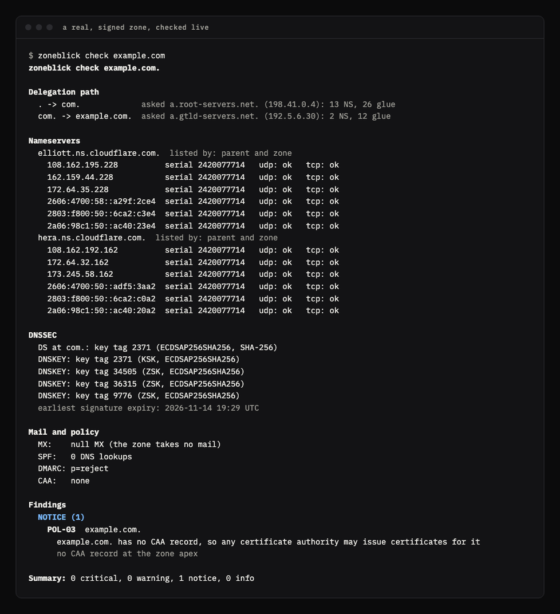
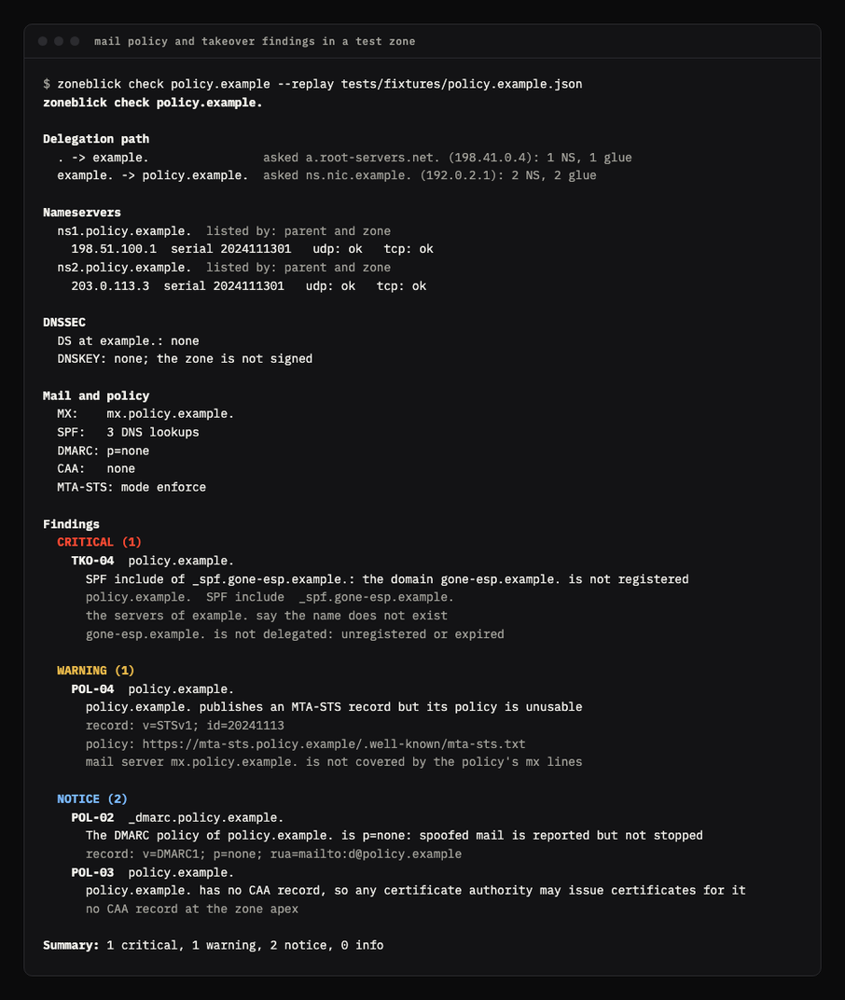
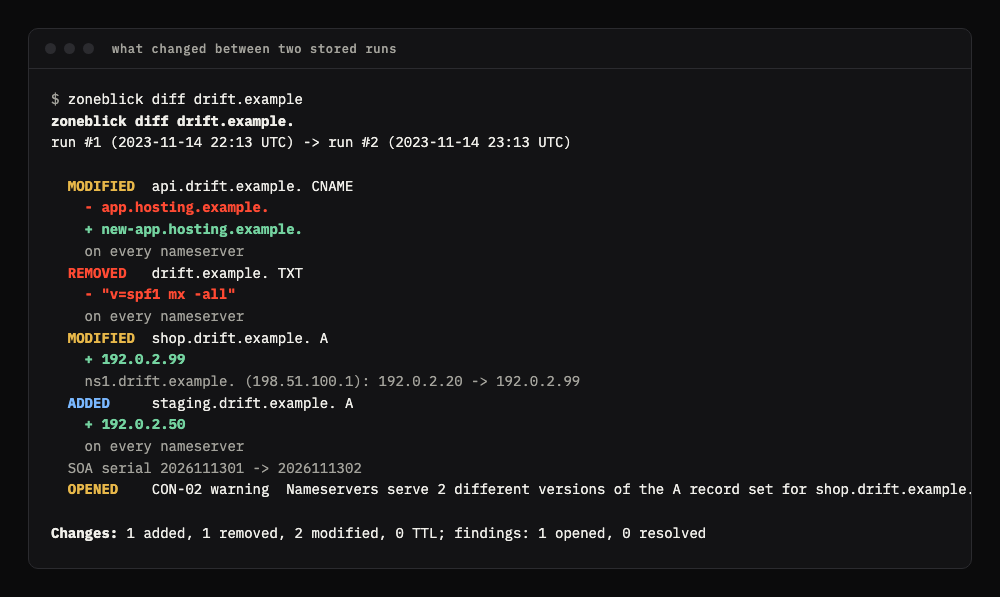

# zoneblick

A self-hosted DNS zone watchdog. zoneblick asks every authoritative nameserver for every record you care about, checks the answers, and keeps a history, so you know when your DNS drifts.

**Status:** early, but usable end to end. `zoneblick check` checks a zone once: delegation, nameserver consistency, DNSSEC, mail policy and takeover exposure. `zoneblick run` stores each run in a SQLite file and `zoneblick diff` shows what changed. `zoneblick serve` runs as a daemon: it checks your zones on a schedule, sends alerts when something changes, and serves a JSON API and a web UI. It can find more names in certificate logs or by zone transfer, compare against a pinned baseline, mute findings you have accepted, export findings as JSON or CSV, and thin out old runs by itself. All 26 checks of the v1 design are built, and so are 11 of the 14 deep checks (`--deep`). The current release, `v0.8.0`, is an early pre-release.

- Website: https://zoneblick.com
- Demo with sample data: https://zoneblick.com/demo.html
- Design document: [DESIGN.md](DESIGN.md)

## What it looks like

A check of a deliberately broken test zone. One nameserver refuses queries for the zone, and the other two serve different SOA serials:


A real, signed zone, checked live:



Mail-policy and takeover findings, in a test zone whose SPF record includes a domain nobody has registered:



What changed between two stored runs of a zone:



The web UI that `zoneblick serve` provides. This picture is of the [demo](https://zoneblick.com/demo.html), which is the same interface filled with invented sample data, including a few checks that are not built yet:


## Platforms

zoneblick runs on Linux, macOS and Windows. The same tests run on all three in CI on every change.

| | Linux | macOS | Windows |
|---|---|---|---|
| Release binary | x86_64 and ARM 64-bit | Apple Silicon and Intel | 64-bit x86 (runs on ARM PCs through emulation) |
| Archive | `.tar.gz` | `.tar.gz` | `.zip` |
| Extra packages needed | None; the binary is statically linked, SQLite included | None | None |
| Signed | Not applicable | No; see the [macOS note](#macos-apple-could-not-verify-warning) | No |
| Install with | `curl`, `tar`, `sudo install` | `curl`, `tar`, `sudo install` | PowerShell |
| Build from source | Yes | Yes | Yes |
| Colour output | Yes | Yes | Yes, in Windows Terminal and PowerShell 7; the old console may show raw escape codes |

On every platform:

- Colour is used only when the output is a terminal. Set the `NO_COLOR` environment variable to turn it off.
- zoneblick sends its own DNS queries to port 53 over UDP and TCP, so outbound DNS must be allowed. It does not use the system resolver.
- IPv6 checks need working IPv6 on the machine. Without it, the IPv6 checks are skipped and the report says so.

## Install

There are four ways to install zoneblick: the install script, a binary download, Docker, or building from source.

### Install script (Linux and macOS)

```
curl -fsSL https://zoneblick.com/install.sh | sh
```

The script downloads the newest release for your system, verifies its SHA-256 checksum, and installs the binary to `/usr/local/bin`. Read it first if you like: it is [`install.sh`](install.sh) in this repository.

On Linux with systemd, **run as root** it also sets up the daemon: a `zoneblick` system user, a starter config at `/etc/zoneblick/zoneblick.toml`, a data directory at `/var/lib/zoneblick`, and a `zoneblick` service, which it starts. Add your zones to the config and run `systemctl restart zoneblick`. An existing config is never overwritten.

| Option | Effect |
|---|---|
| `--version v0.8.0` | Install that release instead of the newest |
| `--prefix DIR` | Install the binary to `DIR/bin` |
| `--no-service` | Binary only; no user, config or service |

Pass options after `sh -s --`, for example `curl -fsSL https://zoneblick.com/install.sh | sh -s -- --no-service`.

### Docker

Each release is published as a multi-architecture image (x86_64 and ARM 64-bit) at `ghcr.io/cschweda/zoneblick`.

```
curl -fsSLO https://raw.githubusercontent.com/cschweda/zoneblick/main/compose.yaml
curl -fsSL https://raw.githubusercontent.com/cschweda/zoneblick/main/packaging/zoneblick.docker.toml -o zoneblick.toml

# choose a token and put its hash in zoneblick.toml as token_sha256
TOKEN=$(openssl rand -hex 32); echo "your token: $TOKEN"
docker run --rm ghcr.io/cschweda/zoneblick:latest token "$TOKEN"

# edit zoneblick.toml: paste the hash, list your zones
docker compose up -d
```

Then open `http://127.0.0.1:8053` and enter the token. The container listens on all its interfaces, so a token is required; `compose.yaml` publishes the port on the host's localhost only. Data lives in the `zoneblick-data` volume. The image contains only the static binary and CA certificates and runs as an unprivileged user.

### Download a binary

Each release on the [releases page](https://github.com/cschweda/zoneblick/releases) has a ready-built binary for these systems. The current release is `v0.8.0`.

| System | File name ends in |
|---|---|
| Linux, x86_64 (most servers and VPSs) | `x86_64-unknown-linux-musl.tar.gz` |
| Linux, ARM 64-bit (Raspberry Pi, ARM servers) | `aarch64-unknown-linux-musl.tar.gz` |
| macOS, Apple Silicon | `aarch64-apple-darwin.tar.gz` |
| macOS, Intel | `x86_64-apple-darwin.tar.gz` |
| Windows, 64-bit | `x86_64-pc-windows-msvc.zip` |

The Linux binaries are statically linked, so they run on any distribution with no other packages. The Windows binary also runs on ARM PCs through emulation.

Each set of commands below downloads the binary, installs it and runs a first check. Change `v0.8.0` to install another release.

**Linux**

```
V=v0.8.0
T=$(uname -m)-unknown-linux-musl

curl -LO https://github.com/cschweda/zoneblick/releases/download/$V/zoneblick-$V-$T.tar.gz
tar -xzf zoneblick-$V-$T.tar.gz
sudo install zoneblick-$V-$T/zoneblick /usr/local/bin/

zoneblick check example.org
```

**macOS**

```
V=v0.8.0
A=$(uname -m); [ "$A" = arm64 ] && A=aarch64
T=$A-apple-darwin

curl -LO https://github.com/cschweda/zoneblick/releases/download/$V/zoneblick-$V-$T.tar.gz
tar -xzf zoneblick-$V-$T.tar.gz
sudo mkdir -p /usr/local/bin
sudo install zoneblick-$V-$T/zoneblick /usr/local/bin/

zoneblick check example.org
```

**Windows (PowerShell)**

```
$V = "v0.8.0"
$T = "x86_64-pc-windows-msvc"

Invoke-WebRequest "https://github.com/cschweda/zoneblick/releases/download/$V/zoneblick-$V-$T.zip" -OutFile zoneblick.zip
Expand-Archive zoneblick.zip -DestinationPath .

& ".\zoneblick-$V-$T\zoneblick.exe" check example.org
```

On Windows the binary stays in the unpacked folder. To run `zoneblick` from any folder, move `zoneblick.exe` to a folder on your `PATH`. The Windows binary is not signed.

Each release also has a `SHA256SUMS` file. To check a download against it, on Linux:

```
curl -LO https://github.com/cschweda/zoneblick/releases/download/$V/SHA256SUMS
sha256sum --check --ignore-missing SHA256SUMS
```

On macOS the last line is `shasum -a 256 --check --ignore-missing SHA256SUMS`. On Windows, compare the output of `Get-FileHash zoneblick.zip` with the line for the zip in `SHA256SUMS`.

To update, repeat the steps with a newer release. To remove zoneblick, delete the binary (`/usr/local/bin/zoneblick`, or the unpacked folder on Windows).

#### macOS: "Apple could not verify" warning

The macOS binaries are not signed or notarised by Apple, because that needs a paid Apple developer account. If you download the archive with a web browser, macOS marks it as quarantined and refuses to run the binary, with a message such as *"zoneblick" cannot be opened because Apple cannot verify that it is free of malware*.

Either of these avoids it:

- Download with `curl`, as in the commands above. Files fetched with `curl` are not quarantined.
- Or remove the quarantine mark from a browser download after unpacking it:

  ```
  xattr -d com.apple.quarantine zoneblick-*/zoneblick
  ```

Check the download against `SHA256SUMS` first, since that is the only verification an unsigned binary has. Building from source avoids the question altogether.

### Build from source

You need a stable [Rust toolchain](https://rustup.rs), version 1.88 or later, and a C compiler, because SQLite is compiled in (`gcc` or `clang` on Linux, the Xcode command line tools on macOS, the Visual Studio build tools on Windows).

```
cargo install --git https://github.com/cschweda/zoneblick
```

This builds the latest source and puts the `zoneblick` binary in `~/.cargo/bin`, which rustup adds to your `PATH`. Check it with `zoneblick --version`. The same command works on Linux, macOS and Windows.

To install from a local checkout instead:

```
git clone https://github.com/cschweda/zoneblick
cd zoneblick
cargo install --path .
```

| To | Run |
|---|---|
| Update | The install command again, with `--force` |
| Install somewhere else | Add `--root /usr/local` (the binary goes in `/usr/local/bin`) |
| Remove | `cargo uninstall zoneblick` |

zoneblick is one binary. `check`, `run` and `diff` need no config file; only `run` and `serve` write anything, to the database file. It is not on crates.io.

## Try it

Once installed:

```
zoneblick check example.com
```

Or, without installing, run it from a checkout with `cargo run -- check example.com`.

`check` resolves the zone from the root servers, asks every authoritative nameserver directly over UDP and TCP, IPv4 and IPv6, reads the zone's DNSSEC keys and signatures and its mail and policy records, and reports what is wrong. It needs no config file and no database, and it never uses your system resolver for zone data.

```
zoneblick check example.com.

Delegation path
  . -> com.             asked a.root-servers.net. (198.41.0.4): 13 NS, 26 glue
  com. -> example.com.  asked a.gtld-servers.net. (192.5.6.30): 2 NS, 12 glue

Nameservers
  elliott.ns.cloudflare.com.  listed by: parent and zone
    108.162.195.228          serial 2418004112   udp: ok   tcp: ok
    ...

DNSSEC
  DS at com.: key tag 2371 (ECDSAP256SHA256, SHA-256)
  DNSKEY: key tag 2371 (KSK, ECDSAP256SHA256)
  DNSKEY: key tag 34505 (ZSK, ECDSAP256SHA256)
  earliest signature expiry: 2026-11-14 18:16 UTC

Mail and policy
  MX:    null MX (the zone takes no mail)
  SPF:   0 DNS lookups
  DMARC: p=reject
  CAA:   none

Findings
  NOTICE (1)
    POL-03  example.com.
      example.com. has no CAA record, so any certificate authority may issue certificates for it
      no CAA record at the zone apex

Summary: 0 critical, 0 warning, 1 notice, 0 info
```

To see findings without touching the network, replay the deliberately broken test zone from a checkout of this repository:

```
zoneblick check broken.example --replay tests/fixtures/broken.example.json
```

## Track changes over time

`run` does everything `check` does, then asks every nameserver for the records of the names you care about, and stores the result in a SQLite file:

```
zoneblick run example.org --name www --name api --name mail
```

- **Names** are given once. They are remembered in the database, so later runs are just `zoneblick run example.org`. Use `--forget-name` to stop checking one. The zone apex is always checked.
- **Record types** asked for each name: A, AAAA, CNAME, MX, TXT and CAA, plus SOA and NS at the apex.
- **The database** is `zoneblick.sqlite` in the current directory unless you pass `--db FILE`. It is created on the first run. It holds the names in your zones and any problems found, so keep it private.

Each run after the first ends with what changed since the previous one. `diff` shows the same comparison for any two stored runs:

```
zoneblick diff example.org
zoneblick diff example.org --from 12 --to 40
zoneblick diff example.org --ignore "_acme-challenge.*"
zoneblick zones list
```

```
zoneblick diff drift.example.
run #1 (2023-11-14 22:13 UTC) -> run #2 (2023-11-14 23:13 UTC)

  MODIFIED  api.drift.example. CNAME
    - app.hosting.example.
    + new-app.hosting.example.
    on every nameserver
  REMOVED   drift.example. TXT
    - "v=spf1 mx -all"
    on every nameserver
  MODIFIED  shop.drift.example. A
    + 192.0.2.99
    ns1.drift.example. (198.51.100.1): 192.0.2.20 -> 192.0.2.99
  ADDED     staging.drift.example. A
    + 192.0.2.50
    on every nameserver
  SOA serial 2026111301 -> 2026111302
  OPENED    CON-02 warning  Nameservers serve 2 different versions of the A record set for shop.drift.example.

Changes: 1 added, 1 removed, 2 modified, 0 TTL; findings: 1 opened, 0 resolved
```

You can reproduce that output offline from a checkout, using two recorded states of a test zone:

```
zoneblick run drift.example --db demo.sqlite --name www --name api --name shop --name staging --replay tests/fixtures/drift.example.before.json
zoneblick run drift.example --db demo.sqlite --replay tests/fixtures/drift.example.after.json
zoneblick diff drift.example --db demo.sqlite
```

### What counts as a change

A change is a difference in what the nameservers, taken together, serve for a name and type. To keep noise down:

- **Rotation is not drift.** If servers hand out different parts of the same pool of records from run to run, nothing is reported.
- **A change on one server is named.** When only some servers changed, the diff lists them with their before and after values. When all did, it says "on every nameserver".
- **TTL changes are reported separately**, as `TTL`, and do not count as a change to the records.
- **The SOA serial** is shown on one line when it moves and is not counted as a change by itself.
- **`--ignore PATTERN`** leaves out names that match; `*` matches anything.
- **Only authoritative answers count.** A server that did not answer in one of the runs is left out of the comparison for that run.

Findings have a lifecycle too: a finding seen in a run is open, and one that is no longer seen is resolved. The diff lists findings that opened or resolved between the two runs.

### Names that rotate

Some names change their addresses all the time, because a CDN or a load balancer hands out a different part of a large pool on each query. zoneblick learns this: when the A or AAAA records of a name have changed in each of three run-to-run steps in a row, the name counts as volatile. From then on, a new set of addresses is shown as `ROTATION` and is not counted as a change, does not set the exit code and sends no alert, as long as every address was already served in one of the last ten runs. An address that was never seen before is still a change, even one next to a known address, and so is anything that is not an address, such as a new CNAME target. Rotations stay visible in `diff`.

### Baselines

A baseline is one stored run that you pin as "this is correct". Comparing against it shows everything that has moved since then, however many runs lie between:

```
zoneblick baseline pin example.org            # pin the latest run; --run 12 pins another
zoneblick diff example.org --baseline         # the baseline against the latest run
zoneblick baseline show example.org
zoneblick baseline clear example.org
```

### Finding more names

`check` and `run` only look at the names you list. `--discover ct` asks Certificate Transparency logs which hostnames in the zone have certificates, and checks those too:

```
zoneblick run example.org --discover ct
```

`--discover axfr` asks the zone's own nameservers for a zone transfer instead, which lists every name in the zone:

```
zoneblick run example.org --discover axfr
```

Most nameservers refuse transfers to strangers, and the run then says so and carries on; it works when your servers allow transfers from the machine zoneblick runs on. Names found this way (at most 500, those with address, alias, mail or text records) are checked from the next run on. A transfer request can look like probing to an intrusion detection system, so ask for it only on your own zones.

The names found are remembered like names given with `--name`; from certificate logs, wildcard entries are left out and at most 200 names are added. The lookup goes to [crt.sh](https://crt.sh), a public search of the logs, so crt.sh learns which zone you asked about. That is why discovery is off unless you ask for it. crt.sh is often slow or briefly unavailable; when it fails, the run says so and carries on with the names it has.

### Findings you have accepted

Some findings are true and intended, such as a zone that deliberately has no CAA record. Mute one and it is still recorded, but it is left out of reports, does not set the exit code, and sends no alert:

```
zoneblick findings list example.org           # every open and muted finding, with its ID
zoneblick findings mute example.org 5524cc29  # the ID, or the start of it
zoneblick findings unmute example.org 5524cc29
```

A run that leaves muted findings out says how many. `findings list --state muted` shows them; `--state resolved` and `--state all` show history.

### Export

`zoneblick export` writes every stored finding with its state and the runs it was first and last seen in, as JSON, or as CSV with `--format csv`; `--zone` limits it to one zone. The output is a list of what is wrong with your zones, so handle it as you would the database. In the CSV, a value that a spreadsheet would read as a formula gets a leading apostrophe.

### Zones in the database

`zoneblick zones add example.org --name www --name mail` stores a zone and its names before the first run. `zoneblick zones remove example.org` deletes a zone with all its runs, names and findings; it does not ask first.

### Old runs

Unchanged record sets are stored only once, so runs are small, but they still add up. `zoneblick prune` deletes old ones: every run younger than 30 days stays, older runs are thinned to the last one of each day, and runs older than a year are deleted. `--keep-all` and `--keep-daily` change the two limits. A zone's latest run and its baseline are never deleted, and the history of findings is kept. The daemon prunes by itself after every round of checks.

## Run it as a daemon

`zoneblick serve` checks every zone in a config file on a schedule, stores each run, alerts you when something changes, and serves an API and a web UI.

```
zoneblick serve --config zoneblick.toml
```

It checks all zones at startup and then once per interval. Stop it with Ctrl-C. The [install script](#install-script-linux-and-macos) sets this up as a systemd service; [`packaging/zoneblick.service`](packaging/zoneblick.service) is the unit for manual installs.

### Configuration

```toml
[server]
bind = "127.0.0.1:8053"           # where the API and web UI listen
data_dir = "/var/lib/zoneblick"    # holds zoneblick.sqlite
# token_sha256 = "..."             # required unless bind is localhost

[schedule]
every = "1h"                       # 45s, 30m, 1h, 2d
max_qps_per_server = 5
# deep = "24h"                    # make a deep run this often; off unless set

[[zone]]
name = "example.org"
seeds = ["www", "api", "mail"]     # names to check besides the apex
ignore = ["_acme-challenge.*"]     # left out of change reports and alerts
# discover = ["ct", "axfr"]        # find more names: certificate logs, zone transfer

[retention]
keep_all = "30d"                   # keep every run this long
keep_daily = "365d"                # then one run per day, until this age

[alerts.webhook]
url = "https://example.org/hooks/zoneblick"

[alerts.ntfy]
url = "https://ntfy.sh/your-topic"
# token = "..."

[alerts.email]
to = "ops@example.org"
from = "zoneblick@example.org"
smtp_host = "smtp.example.org"
# smtp_port = 587
# tls = "starttls"                 # or "tls", or "none"
# username = "zoneblick"
# password_file = "/etc/zoneblick/smtp-password"
```

Every section is optional. Unknown keys are refused, so a typo is reported instead of ignored. With `discover`, the daemon looks for more names at most once a day per zone: `"ct"` asks crt.sh, `"axfr"` asks the zone's nameservers for a zone transfer (see [Finding more names](#finding-more-names)). `deep = "24h"` under `[schedule]` makes one run in that time a [deep run](#deep-checks); left out or `"off"`, the daemon makes no deep runs.

### The API token

The API and UI need no token while `bind` is a localhost address; then zoneblick only answers requests addressed to `localhost`, `127.0.0.1` or `[::1]`. To listen on any other address you must set a token. Pick a long random one and store only its hash:

```
TOKEN=$(openssl rand -hex 32); echo "$TOKEN"
zoneblick token "$TOKEN"        # prints: token_sha256 = "..."
```

Put the printed line under `[server]`. Clients send the token as `Authorization: Bearer <token>`; the web UI asks for it once per browser session. For access from other machines, keep `bind` on localhost and put a reverse proxy with TLS in front.

### Alerts

An alert is sent when something changes state: a finding opens or resolves, records change, or the delegation changes. A finding that stays open does not alert again. On the first run of a zone, every finding counts as new.

| Sink | What is sent |
|---|---|
| Webhook | An HTTP POST with JSON: `zone`, `run`, `severity`, `title`, `text`, `findings_opened`, `findings_resolved`, `changes` |
| ntfy | The text, with the title and a priority taken from the severity |
| Email | A plain-text message over SMTP |

Email has been tested only as far as building the message; it has not been tried against a real mail server yet.

### The web UI

Open the `bind` address in a browser. The page lists your zones with their open findings, a nameserver table, the delegation path, and a history of runs with what changed in each. "Run checks now" starts a run of every zone. The page is a single file compiled into the binary; it loads nothing from other sites.

### The API

JSON under `/api/v1`. All routes except `health` need the token when one is set.

| Route | Returns |
|---|---|
| `GET /health` | `status` and `version`; needs no token |
| `GET /zones` | The stored zones with run and finding counts, and any run errors |
| `GET /zones/{zone}` | One zone: names, runs, the latest run's observations, and its findings |
| `GET /runs?zone=` | The stored runs of a zone |
| `GET /findings?zone=&state=` | Findings with their lifecycle; `state` is `open` or `resolved` |
| `GET /diff?zone=&from=&to=` | The same document as `diff --json` |
| `POST /runs` | Starts a run in the background; body `{}` for all zones or `{"zone": "example.org"}` |
| `GET /ui` | Everything the web UI shows, in one document |

Errors are JSON too: `{"error": {"kind": "...", "message": "..."}}` with a matching HTTP status. Requests that change something must send JSON and must not come from another website.

## Command reference

| Command | What it does | Stores anything |
|---|---|---|
| `zoneblick check <zone>` | Checks the zone once | No |
| `zoneblick run <zone>` | Checks the zone and its names, stores the run, shows changes since the last run | Yes |
| `zoneblick diff <zone>` | Compares two stored runs | No |
| `zoneblick baseline pin\|show\|clear <zone>` | Pins, shows or removes the zone's baseline run | Yes |
| `zoneblick prune` | Deletes old runs | Yes |
| `zoneblick findings list\|mute\|unmute` | Lists findings, or mutes one | Yes |
| `zoneblick export` | Writes the stored findings as JSON or CSV | No |
| `zoneblick zones list` | Lists the stored zones | No |
| `zoneblick zones add\|remove <zone>` | Adds a zone with names, or deletes a zone and its history | Yes |
| `zoneblick serve` | Runs the daemon: schedule, alerts, API and web UI | Yes |
| `zoneblick token` | Prints the hash of an API token for the config file | No |

### Options

| Option | Commands | Effect |
|---|---|---|
| `--json` | all | Print one JSON document instead of text |
| `--db FILE` | every command that reads or writes stored runs | The database file. Default: `zoneblick.sqlite` |
| `--name NAME` | `run` | Also check this name in the zone; repeatable; remembered |
| `--forget-name NAME` | `run` | Stop checking a remembered name; repeatable |
| `--from RUN`, `--to RUN` | `diff` | The runs to compare. Default: the latest and the one before it |
| `--baseline` | `diff` | Compare against the pinned baseline instead of the run before |
| `--ignore PATTERN` | `diff` | Leave out matching names; repeatable |
| `--deep` | `check`, `run` | Also make the [deep checks](#deep-checks) |
| `--discover ct`, `--discover axfr` | `run` | Find more names in certificate logs, or by zone transfer; remembered |
| `--state STATE` | `findings list` | `open`, `muted`, `resolved` or `all`. Default: open and muted |
| `--format json\|csv`, `--zone ZONE` | `export` | The output format, and one zone only |
| `--run RUN` | `baseline pin` | The run to pin. Default: the latest |
| `--keep-all TIME`, `--keep-daily TIME` | `prune` | The retention limits. Default: `30d` and `365d` |
| `--config FILE` | `serve` | The configuration file. Default: `zoneblick.toml` |
| `--record FILE` | `check`, `run` | Save every DNS exchange of the run to a fixture file |
| `--replay FILE` | `check`, `run` | Answer from a fixture file instead of the network |

### Exit codes

For `check` and `run`:

| Code | Meaning |
|---|---|
| `0` | Clean (`info` findings do not count) |
| `1` | Notices or warnings only |
| `2` | At least one critical finding |
| `3` | The run itself failed: bad arguments, zone not found, not a zone apex, no nameserver reachable |

For `diff`: `0` nothing changed, `1` something changed, `3` the command failed (no database, unknown zone or run, fewer than two runs, no baseline). A moved SOA serial alone is not a change, and neither is rotation of a volatile name. The other commands exit `0`, or `3` on failure. Muted findings do not count towards the exit code of `run`. `zones list` exits `0`, or `3` on failure.

### Checks

| ID | Check | Severity |
|---|---|---|
| DEL-01 | Parent NS set differs from child NS set | warning |
| DEL-02 | Lame delegation: listed NS is not authoritative, does not answer, or has no address | critical |
| DEL-03 | Glue at parent differs from the address the NS name resolves to | warning |
| DEL-04 | Fewer than two nameservers, or all in one /24 or /48 | notice |
| DEL-05 | NS target is a CNAME | warning |
| DEL-06 | A nameserver's hostname is in a domain that is not registered | critical |
| CON-01 | SOA serial differs across authoritative servers | warning |
| CON-02 | A record set differs across servers: the apex NS set and SOA fields other than the serial, and with `run`, every name and type it collects | warning |
| CON-03 | Server answers over UDP but not over TCP | warning |
| CON-04 | Server does not answer on a published IPv6 address | notice |
| CON-05 | Server mishandles EDNS or truncation | notice |
| SEC-01 | The parent has a DS record but a nameserver serves no matching DNSKEY, so the zone is bogus | critical |
| SEC-02 | A signature has expired, or is close to expiring | critical / warning |
| SEC-03 | The zone has DNSKEY records but the parent has no DS: signed but not chained | notice |
| SEC-04 | A weak or deprecated algorithm or digest, such as RSA/SHA-1 or a SHA-1 DS | warning |
| SEC-05 | Nameservers serve different keys, or only some sign the SOA | warning |
| POL-01 | More than one SPF record, or an SPF record that needs more than ten DNS lookups | warning |
| POL-02 | No DMARC record, or a DMARC policy of `p=none` | notice |
| POL-03 | No CAA record | notice |
| POL-04 | An MTA-STS record whose policy file cannot be fetched, is invalid, or does not cover the zone's mail servers | warning |
| POL-05 | A mail server (MX target) is a CNAME or has no address | warning |
| TKO-01 | A CNAME points at a name that does not exist | warning |
| TKO-02 | A CNAME points at a hosting service that says nobody has claimed the site | critical |
| TKO-03 | A CNAME or MX points into a domain that is not registered | critical |
| TKO-04 | The SPF record includes or redirects to a domain that is not registered | critical |
| TKO-05 | The zone's wildcard record is an alias of a name outside the zone | notice |

These are the 26 checks of the v1 design, made on every run. If IPv6 does not work on your machine, CON-04 is skipped and one `info` finding says so.

### Deep checks

`zoneblick check <zone> --deep` and `zoneblick run <zone> --deep` add these. They cost a few more queries per nameserver: four unusual SOA queries, three for DNSSEC housekeeping records, and one zone-transfer attempt.

| ID | Check | Severity |
|---|---|---|
| SEC-07 | NSEC3 with extra iterations or a salt (RFC 9276 says 0 and none) | notice |
| SEC-09 | CDS or CDNSKEY records differ between nameservers, or name a key that is not in the DNSKEY set | warning |
| SEC-10 | An algorithm in the DS or DNSKEY set has no signature over the DNSKEY set or the SOA record | warning |
| NSB-01 | A nameserver breaks the EDNS rules: no BADVERS for an unknown version, or an unknown option is not ignored | warning |
| NSB-02 | A nameserver allows a zone transfer to anyone | warning |
| NSB-03 | An authoritative nameserver offers recursion | warning |
| NSB-04 | A nameserver does not keep the upper and lower case of the query name | notice |
| NET-02 | A nameserver address is in private or reserved space | warning |
| SOA-01 | An SOA timer is outside a sane range | notice |
| SOA-02 | The primary named in the SOA record is not a listed nameserver, or has no address | notice |
| SOA-03 | The contact address in the SOA record is at a domain that takes no mail | notice |

Not built yet: SEC-06 (denial-of-existence proofs), SEC-08 (key rollover state) and NET-01 (all nameservers in one network, which needs network-ownership data).

- **Lifecycle.** A light run says nothing about these checks, so a deep finding stays open through light runs and is resolved only by a later deep run that no longer sees it.
- **SOA-01 limits** are loose, to catch mistakes and not tastes: refresh at least 20 minutes, retry at least 2 minutes and shorter than refresh, expire at least a week and longer than refresh, negative-caching TTL between a minute and a day.
- **SOA-02** also fires for a hidden primary, which is a legitimate design. Mute it if that is yours.
- **NSB-02** makes one transfer request per nameserver and reads only the first answer: it records whether the transfer was allowed and keeps none of the zone. Like the odd EDNS queries, it can look like probing to an intrusion detection system, which is one more reason to run deep checks only on your own zones.

**Takeover checks.** TKO-01, TKO-02 and the CNAME part of TKO-03 look at the CNAME records of the names you list, so they need `run` or `serve`; `check` covers the apex only. "Not registered" is decided from DNS alone: the name does not exist and the server that says so belongs to a top-level domain, which means the domain itself is not delegated. Domains under two-level suffixes such as `co.uk` are not recognised this way and are reported as TKO-01 instead. DEL-06 uses the same test for the domains of nameservers. zoneblick never tries to claim anything.

**Service signatures (TKO-02).** When a listed name is a CNAME to one of eleven hosting services (GitHub Pages, Amazon S3, Surge, Read the Docs, Pantheon, Tilda, Strikingly, WordPress.com, Help Scout, UserVoice and Cargo), `run` fetches the front page of your hostname once over plain HTTP, without following redirects, and compares it with the page that service shows for a site nobody has claimed. A match is a critical finding: anyone with an account at the service can claim the site and serve your hostname. At most twenty hostnames are fetched per run. The page texts come from the MIT-licensed [nuclei-templates](https://github.com/projectdiscovery/nuclei-templates) project (see [`THIRD-PARTY.md`](THIRD-PARTY.md)); they go stale when a service changes its error page, so a clean result is not proof that an alias is safe. A service that is not on the list is not checked at all.

**Wildcards (TKO-05).** zoneblick asks for the record `*.<zone>` itself. When it is a CNAME to a name outside the zone, every hostname nobody created is served by that outside service, which is worth knowing even when it is intended.

**The DNSSEC checks are beta.** They read the DS record at the parent, each nameserver's DNSKEY set, and the dates on the signatures over the DNSKEY and SOA records. They check that the DS matches a key (key tag, algorithm and SHA-256 or SHA-384 digest) but do not yet verify the signatures themselves, so a zone with a valid-looking chain and a corrupt signature is not caught. For SEC-02, "close to expiring" means within seven days, or within a quarter of the signature's own lifetime when that is shorter, so zones signed on the fly with one- or two-day signatures do not warn constantly. An unsigned zone produces no DNSSEC findings.

### Politeness

At most 16 queries are in flight at once and no server address gets more than 5 queries per second. UDP queries time out after 3 seconds and TCP after 5; a timed-out query is retried twice, after 0.5 and 1 second. A check sends seven queries to each nameserver address (five probes and two for DNSSEC), one to the parent for the DS record, and a handful for the mail and policy records, including one per SPF include and one HTTPS request for an MTA-STS policy file when the zone publishes one. SPF includes are followed for at most 30 lookups. A stored run adds six queries per name to each address that answered.

## JSON output

`--json` prints one document. `schema_version` changes only when a field is removed, renamed or changes meaning; new fields may be added without a change. Field order is fixed, and findings and probes are sorted, so the same observations always give the same bytes. Names are lowercase and fully qualified, with a trailing dot.

| Field | Contents |
|---|---|
| `schema_version` | `1` |
| `zone` | The zone checked |
| `started_at_unix` | Start of the run, in seconds since the Unix epoch. The only time-dependent field |
| `vantage` | `ipv4`, `ipv6`: whether each address family works from this machine |
| `delegation_path` | Referrals from the root down. Each has `from_zone`, `to_zone`, `server_name`, `server_address`, `ns` and `glue` (`name`, `address`) |
| `nameservers` | One per NS hostname: `name`, `in_parent`, `in_child`, `glue`, `resolved`, `cname`, `resolve_error` |
| `probes` | Every query to every nameserver address: `ns_name`, `address`, `qtype`, `transport`, `edns`, `outcome` |
| `dnssec` | `parent_ds` (the DS records one parent server served, or an `error`) and `servers` (per address: `dnskeys`, `dnskey_sigs`, `soa_sigs`) |
| `policy` | `apex_txt`, `dmarc`, `caa`, `mx` (each a lookup with `status`, `rdata`, `cname`, `enclosing`), `spf` (`records`, `lookups`), `mta_sts`, and `targets` (where MX and CNAME targets lead) |
| `records` | Only from `run`: one entry per name, type and server, with `name`, `qtype`, `ns_name`, `address`, `transport` and `outcome` |
| `findings` | See below |
| `summary` | Counts: `critical`, `warning`, `notice`, `info` |
| `exit_code` | The process exit code |

A probe `outcome` has a `kind`: `response` (with `rcode`, `authoritative`, `truncated`, `opt_present`, `size`, `soa`, `ns`), `timeout`, `net_error` (with `message`) or `malformed` (with `message`).

Each finding has `check_id`, `severity`, `name`, `summary` (one line for people) and `evidence`. Evidence has a `kind` that fixes its other fields:

| Check | Evidence `kind` | Fields |
|---|---|---|
| DEL-01 | `ns_set_mismatch` | `parent`, `child`, `only_in_parent`, `only_in_child` |
| DEL-02 | `lame_server` | `ns_name`, `address`, `reason` (`not_authoritative`, `no_response`, `unresolvable`), `probes` |
| DEL-03 | `glue_mismatch` | `ns_name`, `glue`, `resolved` |
| DEL-04 | `too_few_nameservers` | `nameservers` |
| DEL-04 | `single_network` | `prefix`, `addresses` |
| DEL-05 | `ns_is_cname` | `ns_name`, `target` |
| CON-01 | `serial_mismatch` | `serials`: list of `value` and `servers` |
| CON-02 | `rrset_mismatch` | `rrtype`, `variants`: list of `value` and `servers` |
| CON-03 | `no_tcp` | `ns_name`, `address`, `probes` |
| CON-04 | `ipv6_unreachable` | `ns_name`, `address`, `probes` |
| CON-04 | `ipv6_not_tested` | `addresses` |
| CON-05 | `edns_problem` | `ns_name`, `address`, `problems` |
| SEC-01 | `ds_without_key` | `ds`, `servers`: list of `value` (the keys served) and `servers` |
| SEC-02 | `signature_expiry` | `type_covered`, `key_tag`, `expiration_unix`, `seconds_left`, `servers` |
| SEC-03 | `signed_not_chained` | `dnskeys` |
| SEC-04 | `weak_algorithm` | `items` |
| SEC-05 | `signatures_differ` | `variants`: list of `value` and `servers` |
| POL-01 | `spf_problem` | `records`, `lookups`, `chain` |
| POL-02 | `dmarc_problem` | `record`, `policy` |
| POL-03 | `no_caa` | none |
| POL-04 | `mta_sts_problem` | `record`, `policy_url`, `problems` |
| POL-05 | `mail_target_problem` | `target`, `problem`, `cname` |
| DEL-06, TKO-01, TKO-03, TKO-04 | `dangling_target` | `owner`, `rtype`, `target`, `said_by`, `unregistered_domain` |
| TKO-02 | `unclaimed_service` | `owner`, `target`, `service`, `url`, `status` |
| TKO-05 | `wildcard_alias` | `wildcard`, `target` |
| NSB-01 to NSB-04 | `server_behaviour` | `ns_name`, `address`, `details` (a list of lines) |
| SEC-07, SEC-09, SEC-10, NET-02, SOA-01 to SOA-03 | `zone_detail` | `details` (a list of lines) |

A full example is in [`tests/fixtures/broken.example.report.json`](tests/fixtures/broken.example.report.json); a test pins it byte for byte.

A record `outcome` has a `kind`: `answer` (with `rcode`, `authoritative`, `ttl` and `rdata`, a sorted list of record data in text form), `timeout`, `net_error` or `malformed`.

### `run --json`

| Field | Contents |
|---|---|
| `schema_version` | `1` |
| `run` | `id`, `db`, `names` (checked besides the apex), `queries` |
| `report` | The document described above, with `records` |
| `diff` | The diff against the previous stored run, or `null` for the first run |

### `diff --json`

| Field | Contents |
|---|---|
| `schema_version` | `1` |
| `zone` | The zone |
| `from`, `to` | The two runs: `id`, `started_at_unix` |
| `changes` | One per changed record set: `name`, `rtype`, `kind` (`added`, `removed`, `modified`, `ttl`), `added`, `removed`, `ttl_before`, `ttl_after`, `servers` (each with `ns_name`, `address`, `before`, `after`), `all_servers`, and `rotation: true` when it is rotation of a volatile name (left out otherwise) |
| `soa_serial` | `before` and `after` when the serial moved, otherwise `null` |
| `delegation` | `ns_added`, `ns_removed`, `glue_added`, `glue_removed` when the parent's delegation changed, otherwise `null` |
| `findings_opened`, `findings_resolved` | Each with `severity`, `check_id`, `name`, `summary`, `fingerprint` |
| `not_compared` | Record sets left out: `name`, `rtype`, `reason` (`ignored`, `not_in_older_run`, `not_in_newer_run`) |
| `summary` | Counts: `added`, `removed`, `modified`, `ttl`, `findings_opened`, `findings_resolved` |
| `changed` | `true` when anything other than the SOA serial changed |

A full example is in [`tests/fixtures/drift.example.diff.json`](tests/fixtures/drift.example.diff.json), also pinned by a test.

When the run fails, the document is shorter:

```json
{
  "schema_version": 1,
  "zone": "nothing.invalid.",
  "error": {
    "kind": "zone_not_found",
    "message": "zone nothing.invalid. does not exist (NXDOMAIN)"
  },
  "exit_code": 3
}
```

`error.kind` is one of `invalid_name`, `no_network`, `zone_not_found`, `not_a_zone`, `servers_failed`, `too_many_referrals`, `no_server_reachable`, `name_outside_zone`, `no_database`, `unknown_zone`, `unknown_run`, `not_enough_runs`, `store_error`, `fixture_error`.

## Development

```
cargo fmt --check
cargo clippy --all-targets -- -D warnings
cargo test                 # offline
cargo test -- --ignored    # the one test that uses the live network
```

Tests never use the network. Checks are tested against hand-built observations, and the resolver against recorded DNS exchanges in `tests/fixtures/`, replayed through the same code path as a live run. The `broken.example`, `good.example`, `drift.example`, `signed.example` and `policy.example` test zones are generated from `tests/common/mod.rs`; `example.com.json` is a recording of a real run. After an intended change, regenerate the generated files with `ZONEBLICK_REGEN=1 cargo test`.

The same lint and tests run in CI on Linux, macOS and Windows for every push and pull request (`.github/workflows/ci.yml`).

### Releasing

Binaries are built by GitHub Actions (`.github/workflows/release.yml`). To publish a release, set the version in `Cargo.toml`, commit, then push a matching tag:

```
git tag v0.9.0
git push origin v0.9.0
```

The workflow checks that the tag matches the crate version, runs the lint and tests, builds static Linux binaries (x86_64 and aarch64), macOS binaries (Apple Silicon and Intel) and a Windows binary, and attaches them to a GitHub Release with a `SHA256SUMS` file, then publishes the container image to `ghcr.io/cschweda/zoneblick`. Each archive holds the binary, this README, both license files and `THIRD-PARTY.md`. The macOS and Windows binaries are not signed. Versions below 1.0 are marked as pre-releases. A pull request that changes the workflow or the Cargo files runs the same builds without publishing.

## What it will do

- **Zone health:** delegation, nameserver consistency, DNSSEC. All three have checks now, with a deep level for nameserver behaviour, SOA values and DNSSEC details; signature verification and three of the deep checks are still to come.
- **Exposure:** dangling records and subdomain-takeover risk. Dangling aliases, unregistered domains and aliases of unclaimed sites at known hosting services are detected now.
- **Drift history:** every run stored and compared with the last, on a schedule, with alerts. All of this exists now, with pinned baselines, learned rotation and retention.

One binary, one config file, one SQLite file, on your own server.

## Repository layout

| Path | Contents |
|---|---|
| `DESIGN.md` | High-level design |
| `DECISIONS.md` | Decisions made during implementation, one line each |
| `LICENSE-MIT`, `LICENSE-APACHE` | The two licenses |
| `.github/workflows/release.yml` | Builds and publishes release binaries |
| `KICKOFF.md` | Claude Code prompt for Phase 0 |
| `src/observe.rs` | The recorded observations of a run (plain data) |
| `src/resolver/` | Iterative resolver, per-server probing, transport, record and replay |
| `src/checks/` | The checks: pure functions over observations, no I/O |
| `src/output/` | Terminal and JSON rendering |
| `src/dnssec.rs` | DNSSEC record parsing, key tags and DS digests |
| `src/store.rs` | The SQLite store: snapshots, record sets, finding lifecycle |
| `src/diff.rs` | The diff engine: pure functions over two stored runs |
| `src/resolver/deep.rs`, `src/checks/deep.rs` | The deep probes and the deep checks |
| `src/discover.rs` | Finding names in certificate logs and by zone transfer |
| `src/signatures.rs` | The hosting-service signatures for TKO-02 |
| `THIRD-PARTY.md` | Where the signatures come from, and their licence |
| `src/config.rs` | The `zoneblick.toml` configuration file |
| `src/serve.rs` | The daemon: scheduler, API and UI data |
| `src/alerts.rs` | Composing and sending alerts |
| `src/runner.rs` | The store-and-compare step shared by `run` and `serve` |
| `src/ui/index.html` | The web UI, compiled into the binary |
| `install.sh`, `compose.yaml`, `packaging/` | Install script, Docker Compose file, systemd unit and image recipe |
| `src/cli.rs` | The commands |
| `tests/` | Offline tests and DNS fixtures |
| `screenshots/` | The images in this README |
| `.github/workflows/ci.yml` | Lint and tests on Linux, macOS and Windows |
| `docs/` | The project website, served by GitHub Pages |

## Responsible use

Scan only zones you control.

## Privacy

zoneblick sends no telemetry. The binary talks to DNS servers, to the alert destinations you configure, to a zone's own `mta-sts` host when that zone publishes an MTA-STS record, to your own hostnames that are aliases of a known hosting service (one page each, for TKO-02), and to crt.sh when you turn certificate-log discovery on, and to nothing else; the web UI loads nothing from other sites. The project website, zoneblick.com, uses [Plausible](https://plausible.io) for privacy-friendly, cookie-free visit statistics.

## License

zoneblick is licensed under either of these, at your option:

- MIT license ([LICENSE-MIT](LICENSE-MIT))
- Apache License, Version 2.0 ([LICENSE-APACHE](LICENSE-APACHE))

This is the usual dual license for Rust projects. You may use, change and redistribute zoneblick under whichever of the two suits you.

Unless you state otherwise, any contribution you intentionally submit for inclusion in zoneblick, as defined in the Apache-2.0 license, is dual licensed as above, without any additional terms or conditions.
